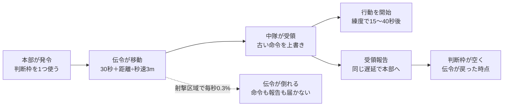
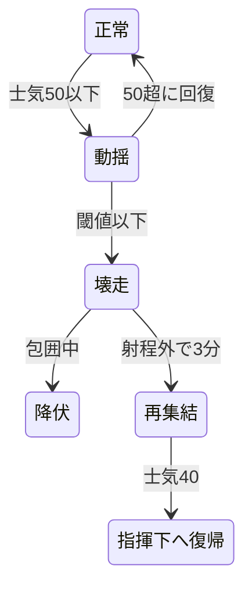

# 大隊指揮RTS プロトタイプ仕様書

2026-10-16 時点のスナップショット。原本は claude.ai 上の「大隊指揮RTS プロトタイプ仕様書」。リポジトリ内ではこのファイルを正とし、変更時は原本と同期する。

## 目的と検証仮説

この試作は、1会戦だけで「包囲と砲撃が気持ちよく決まるか」と「負けた理由が分かるか」を確かめる。絵、キャンペーン、物語は作らない。

| ID | 仮説 | 合格基準 | 測り方 |
| --- | --- | --- | --- |
| H1 | 包囲と砲撃の集中が気持ちよく決まる | テスター5人中4人以上が、印象に残った場面として包囲・壊走・砲撃のいずれかを自発的に挙げる | プレイ後の聞き取り（誘導しない質問） |
| H2 | 負けたとき、理由を理解できる | 敗北したテスターの8割以上が、戦闘ログ上の主因と一致する理由を説明できる | 敗北直後に「なぜ負けたと思うか」を聞き、ログと照合 |
| H3 | 同数の正面衝突は高くつき、側面攻撃は決着が速い | 300mで撃ち合う同数の正面衝突では、壊走までの時間の5パーセンタイルがゲーム内時間20分以上。同じ2対1でも、側面攻撃は正面攻撃の半分以下の時間で壊走させ、攻撃側の損害も小さい | 自動対戦のバッチ実行（各100回以上、分布で判定） |
| H4 | 命令の遅延が「読み」を生む | テスターの半数以上が、遅延を見越して早めに命令を出す行動を取る。「理不尽」という感想が半数未満 | 命令ログ（発令時刻と状況）と聞き取り |

H3は人間のテストの前に自動対戦で満たす。H1が2回の調整でも合格しない場合は、戦闘解決の設計を見直す。

## スコープ

試作は「1マップ・1会戦・自軍4中隊＋砲兵1、敵は同等」に限る。

| 含める | 含めない |
| --- | --- |
| 一時停止できるリアルタイムと倍速（×1、×2、×4） | キャンペーン、章構成、上層部の評価 |
| 中隊の向き・士気・拘束・壊走・包囲判定 | 作戦層（会戦の前の移動・補給線） |
| 伝令の遅延、判断枠、通信途絶と自律行動 | 戦訓・装備到着・支援枠などの成長要素 |
| 砲兵（観測、要請から着弾、弾薬、地形荒廃） | 対砲兵戦、航空、戦車 |
| 霧と報告（遅延・誤差） | 練度の消耗と補充 |
| 練度（3段階、個別に設定） | 立ち絵・会話・ボイス（立ち絵は頭文字の丸で代用） |
| 敵AI（方針3つ、評価と方針転換） | 敵指揮官の性格、敵の目標推定 |
| 作戦目標「奪取」「遅滞」の2種 | その他の作戦目標、途中の任務変更 |
| 無線ログ、戦闘詳報（敗因の表示） | セーブ・ロード、設定画面、音 |
| 自動対戦（AI同士、ヘッドレスのバッチ実行） | マルチプレイ |

## 技術方針

Unity 6.3 LTS（C#）で作る。戦闘シミュレーションは Unity に依存しない純粋な C# で書き、画面と切り離す。

- **シミュレーション層**：固定刻み（1刻み＝ゲーム内時間0.5秒）。乱数はシード固定で再現性を持つ
- **表示層**：Unity はシミュレーションの状態を読んで描くだけ。2D、軍隊符号と図形
- **入力層**：プレイヤーの命令も敵AIの命令も、同じ「命令オブジェクト」として渡す。AI 同士の対戦がそのまま成立する
- **パラメータ**：数値はすべて JSON に外出しする
- **ログ**：全イベントを JSON Lines で記録。戦闘詳報、H2 の照合、H3 の集計はこのログから作る
- **テスト**：シミュレーション層は EditMode テストで検証。自動対戦のバッチもテストランナーから実行
- **版管理**：Git タグで工程を区切る
- **独立性**：このリポジトリは他のプロジェクトのコードに依存せず、単独で成立させる

## 時間と命令系統

命令は伝令で運ばれ、距離に応じて遅れて届く。一時停止中に出した命令も例外ではなく、再開後に同じ遅延を経て届く。



伝令が倒れた場合、本部には「受領報告が来ない」という形でしか伝わらない。判断枠は発令から一定時間（初期値：往復予定時間の1.5倍）で強制的に空く。

### 時間

- ゲーム内時間で全てを定義する。×1 は「現実1秒＝ゲーム内時間4秒」、×2、×4 はその倍
- いつでも一時停止できる。停止中も命令の作成と地図の確認はできる
- 試作の会戦はゲーム内時間60〜90分を想定（×1 で現実15〜23分）

### 命令

命令は「目標と意図」で与える。経路や射撃目標の細部は中隊が決める。

| 命令 | 内容 |
| --- | --- |
| 前進 | 指定地点へ移動。接敵したら交戦しつつ前進を続ける |
| 攻撃 | 指定した敵中隊に接近して交戦する。向きを指定できる（側面に回り込む経路を中隊が探す） |
| 保持 | 現在地または指定地点を守る。向きを指定する |
| 拘束 | 敵を射撃で釘付けにする。前進も後退もしない |
| 後退 | 指定地点へ下がる。交戦中なら「離脱」のルールが適用される |
| 陣地構築 | 指定した地点へ移動して塹壕を掘る（地点を指定しなければその場で）。10分で完成。掘りかけでも段階的に効果 |
| 砲撃要請 | 砲兵の節を参照 |

### 伝令の遅延

- 到着までの時間＝準備30秒＋距離÷伝令の速度（秒速3m）。例：600mなら約230秒
- 伝令は大隊本部から中隊の現在位置へ向かう。中隊が動けば追いかける
- 敵の射撃が届く区域を通ると、伝令が倒れることがある（通過1秒あたり0.3%、初期値）
- 届いた命令は中隊から「受領」の報告が同じ遅延で本部に戻る
- 新しい命令は古い命令を上書きする。届くまでは古い命令で動き続ける

### 判断枠

同時に送り出せる伝令は3人まで。伝令が本部に戻るまで枠は空かない。

### 通信途絶と自律行動

- 伝令が倒れる、またはシナリオのイベントで、特定の中隊との連絡が途絶える
- 最後の命令を受けてから5分以上が経ち、状況が大きく変わった場合（敵の出現、士気の低下、隣の中隊の壊走など）、中隊は中隊長の性格で自律行動を始める
- 自律行動は無線ログに「（独断）」として記録される

## マップと地形

マップは3km×2km。部隊の位置は連続座標（メートル）で持ち、地形は50m四方の格子（60×40マス）で引く。

| 地形 | 移動 | 被弾（損害倍率） | 視界 |
| --- | --- | --- | --- |
| 平地 | ×1.0 | ×1.0 | 通す |
| 森林 | ×0.5 | ×0.6 | 内部は100mまで。外からは縁の部隊だけ見える |
| 村落 | ×0.7 | ×0.5 | 内部は150mまで |
| 塹壕（構築済み） | ×0.8 | ×0.3 | 通す |
| 砲撃痕 | ×0.6 | ×0.9 | 通す |
| 川 | 橋と浅瀬のみ通行可（浅瀬は×0.3） | — | 通す |

- **高さ**：各マスに標高。稜線は視線を遮る。標高10mごとに視界+10%
- **視界**：基本800m。射程（歩兵の有効射程400m）より遠くが見える
- **移動速度**：平地で歩兵中隊は秒速1.2m。交戦中は×0.5
- **経路探索**：地形の移動コストと敵の射程内に入るコストを足した A*。射程コストの重みは中隊長の性格で変わる

## ユニット

最小単位は中隊（歩兵150名、正面幅200m×奥行50mの矩形）。兵力と士気の数値だけを持つ。砲兵は地図外にいる。

### 属性

| 属性 | 値 | 説明 |
| --- | --- | --- |
| 兵力 | 0〜150 | 射撃力に比例する |
| 士気 | 0〜100 | 壊走の閾値を下回ると壊走する |
| 練度 | 新兵／通常／古参 | 下の表 |
| 向き | 角度 | 正面±60°、側面60〜120°、背面120°以上 |
| 状態 | 下の状態遷移 | 命令の受け付けと能力が変わる |
| 中隊長 | 性格 | 自律行動と命令の解釈 |

### 練度

| 項目 | 新兵 | 通常 | 古参 |
| --- | --- | --- | --- |
| 壊走の閾値（士気） | 35 | 25 | 15 |
| 射撃効率 | ×0.85 | ×1.0 | ×1.2 |
| 士気の減りやすさ | ×1.2 | ×1.0 | ×0.8 |
| 士気の回復速度 | ×0.7 | ×1.0 | ×1.3 |
| 命令を受けてから動き出すまで | 40秒 | 25秒 | 15秒 |
| 報告の位置誤差 | ±150m | ±100m | ±60m |

### 状態



壊走した中隊は、逃げ場があれば再集結して戻ってくるが、包囲中なら降伏して失われる。拘束（敵が150m以内から射撃）は正常・動揺に重なる状態で、後退に離脱ルールが掛かる。

| 状態 | 条件 | 振る舞い |
| --- | --- | --- |
| 正常 | 士気50超 | 命令どおりに動く |
| 拘束 | 敵が150m以内から射撃している | 後退は離脱ルール。移動×0.5 |
| 動揺 | 士気が閾値超、50以下 | 射撃×0.7。前進・攻撃の命令を拒む（保持になる） |
| 壊走 | 士気が閾値以下 | 命令を受け付けず、敵から離れる方向へ逃げる。追撃されると損害×2。隣接する味方の士気を一度だけ−10 |
| 再集結 | 壊走後、敵の射程外で3分経過 | 士気が40まで回復したら指揮下に戻る。その後の状態は士気で決まる（40なら動揺）。兵力はそのまま |

### 離脱

拘束中の後退は、開始時に士気−10、後退中は敵からの被弾×1.3。

### 中隊長の性格

性格は「命令の解釈」と「自律行動」の2箇所にだけ効く。能力値の補正は持たせない。

| 性格 | 命令の解釈 | 自律行動（通信途絶時） |
| --- | --- | --- |
| 慎重 | 射程に入る経路を強く避ける。士気60未満で前進を止めて保持に変える | 近くの遮蔽物まで下がって保持する |
| 冷静 | 命令どおり | 最後の命令を続行する。届かない本部に報告を送り続ける |
| 猪突 | 敵が動揺・壊走したら追撃する。経路は最短を選ぶ | 最も近い敵に攻撃をかける |
| 機敏 | 側面に回れる経路があればそちらを選ぶ | 敵の側面を狙える位置へ移動する |

## 戦闘解決

勝敗は損害より士気で決まる。以下の初期値は自動対戦の簡易モデル（`docs/reference/combat_reference.py`、各300回）で検算済み。

### 射撃（損害）

各中隊は目標を1つ選んで撃つ（P0 詳細の目標選択を参照）。0.5秒ごとに期待値を計算し、ポアソン乱数で実際の損害を決める。

```
λ = k × N_shooter × f_quality × f_range × f_terrain × f_aspect × f_state × Δt
```

| 係数 | 初期値 |
| --- | --- |
| k（兵士1人・1分あたりの殺傷） | 0.0133（同数の中隊が平地で撃ち合うと、毎分約2名ずつ倒れる） |
| f_range | 150m以内 1.3、400mまで 1.0、それ以上は撃たない |
| f_terrain | 地形の表の被弾倍率 |
| f_aspect | 正面 1.0、側面 1.5、背面 2.0（狙われた側から見た角度） |
| f_state | 動揺 0.7、正面の弧の外の敵への射撃 0.5、砲撃で制圧中 0.5 |

### 士気

| 要因 | 士気の変化 |
| --- | --- |
| 損害 | 初期兵力の1%を失うごとに−1.5（側面からの損害は×2、背面は×3） |
| 被弾中 | 毎分−0.5 |
| 初めて側面／背面を撃たれた | 一度だけ−10／−15 |
| 包囲 | 判明時に一度だけ−15、以後毎分−3（塹壕・村では半分） |
| 隣接する味方の壊走 | 一度だけ−10 |
| 射程外で休む | 毎分+1（練度の回復倍率を掛ける。上限70） |

減り幅には練度の「士気の減りやすさ」を掛ける。

### 包囲

包囲は「逃げ道があるか」で判定する。士気50以下になった中隊は、5秒ごとに退路を見積もる。16方位それぞれについて、壊走の速さ（秒速1.8m）で500m逃げる間に、400m以内の敵すべてから背面を撃たれ続けたら何割を失うかを、射撃の基本の式（k・兵力・距離倍率・背面倍率）で見積もる。射手の動揺や非正面の補正、接近戦の倍率は入れない（P1 では視線が通る敵だけを数える）。

- どの方位でも2割以上を失う見込みなら包囲。判明した瞬間に一度だけ士気−15（絶望）、以後毎分−3
- 塹壕・村の中では毎分の低下を半分にする（籠城）
- 壊走する中隊は、見積もり損害が最も少ない方位へ逃げる

包囲中に壊走した中隊は降伏して盤上から消える。正面と背面から撃たれていても、側面に逃げ道があれば包囲にはならない。しきい値の2割は、四方を囲まれた場合（約30%）とそれ以外（15%以下）の間に置いた値で、16〜29%のどこに置いても判定は変わらない。将来は練度や性格でしきい値を変える余地がある（試作では一律）。

### 接近戦

50m以内では、距離倍率を 2.0 に置き換える（150m以内の 1.3 とは重ねない）。その射撃による損害から生じる士気の減少は×1.5。塹壕にいる側は被弾倍率を保つ。接近戦は決着が速く高くつく場面として扱い、H3 の対象外（H3 は300mでの撃ち合いで測る）。

### 開けた場所を進む部隊の被弾（P1b の調整候補）

今の規則では、開けた場所を立って進む中隊も、伏せて撃ち合う中隊と同じ倍率で撃たれる。そのため300mから50mまで詰める約3.5分の損害は数名で済み、横に広い戦列で突撃すると、塹壕の守備を側面から巻き込んで安く勝ててしまう（概算シミュレーションのステージ2「総員突撃」が勝率100%・損害7%）。300mの撃ち合いでは、塹壕の守備は3対1でもほとんど崩れないので、問題は詰める間の損害だけにある。

候補：平地・砲撃痕・橋・浅瀬・塹壕のマスを移動中の中隊は被弾×2（初期値の案。塹壕を越えて進む兵も身をさらす）。パラメータは `terrain.moving_open_damage_mult`（初期値 1.0 ＝無効。P1b で切り替えて試す）。森・村・死角を通る接近と、制圧射撃で守備の射撃を落としてから詰める動きに意味が出る。P1a には入れず、P1b で実際に突撃してみてから値を決める。それでも安ければ、機関銃を P3 と同じ時期に検討する。

### 検算結果

通常練度の中隊（各150名）、平地、300m。時間はゲーム内時間。正解値は `docs/reference/reference_results.json`。

| 対戦 | 壊走まで（中央値） | 壊走まで（5〜95%） | 敗者の損害 | 勝者の損害 |
| --- | --- | --- | --- | --- |
| S1 1対1 正面 | 35.4分 | 28.0〜40.9分 | 約34% | 約34% |
| S2 2対1 正面＋正面 | 17.7分 | 14.3〜20.7分 | 45% | 17% |
| S3 2対1 正面＋側面 | 7.9分 | 6.1〜10.1分 | 26% | 8% |
| S4 2対1 正面＋背面 | 4.1分 | 3.0〜5.9分 | 17% | 5% |
| S5 古参対通常 正面 | 30.0分 | 24.2〜40.7分 | 40% | 30% |
| S6 4対1 四方を囲まれる | 1.3分（300回すべて降伏） | 0.8〜2.0分 | 11% | 2% |

正解値はリファレンス実装 v3（包囲を「逃げ道があるか」で判定し、S6 を追加）の出力。v2 では「2方向から撃たれたら包囲」だったため、S3・S4 は包囲による降伏で早く決着していた。v3 では側面に逃げ道があるため包囲にならず、壊走まで少し長くなる。

- H3 の基準を満たす。側面攻撃は同じ兵力差の正面攻撃の半分以下（約0.45倍）の時間で決着する
- 古参は通常に正面でほぼ確実に勝つが、自分も約3割を失う
- 簡易モデルは移動・地形・接近戦を含まない

## 砲兵

砲兵は強いが、見えている場所にしか撃てず、遅れて着弾し、弾は20分ぶんしかない。

### 編成と弾薬

- 野砲中隊1個（4門）。地図外の自軍後方、射程は地図全域
- 弾薬160発。射撃中は毎分8発（合計20分分）。補給はない

### 要請から着弾まで

1. プレイヤーが地点と射撃時間（1／3／5分）を指定する
2. 要請できるのは、敵の報告位置から200m以内、または会戦前に登録した計画射撃点（最大3箇所）
3. 本部から砲兵へは電話で30秒（判断枠は使わない）
4. 射撃準備に90秒。計画射撃点なら30秒
5. 初弾の誤差は100m。目標を直接見ている味方中隊がいれば1分後に30mになる。計画射撃点は最初から30m

### 効果

着弾半径100mの円に入った中隊は、敵味方を問わず効果を受ける（友軍誤射あり）。

| 対象の地形 | 損害（毎分、兵力比） | 士気（毎分、損害分を含む） | 通常練度が壊走するまで |
| --- | --- | --- | --- |
| 平地 | 6.0% | −15 | 約5分 |
| 森林 | 3.6% | −9.4 | 約8分 |
| 塹壕 | 1.8% | −4.7 | 約16分 |

- **制圧**：砲撃中と終了後1分間、対象の射撃効率は×0.5
- **地形荒廃**：同じマスに累計3分以上着弾すると「砲撃痕」（移動×0.6）
- 敵にも同じ規模の砲兵。対砲兵戦は対象外

## 霧と報告

地図に出る敵は「最後に報告された敵」。味方の位置は試作では正確に表示（味方も報告で表示する設定を検証用に用意）。

### 発見

- 各中隊は視界内の敵中隊を発見する。森林・村落の中の敵は、中の視界距離まで近づくか、敵が発砲すると発見できる
- 報告は命令と同じ伝令の遅延で本部に届く
- 接敵中の中隊は2分ごとに続報を送る。報告の伝令は判断枠を使わない

### 報告の中身

| 項目 | 内容 |
| --- | --- |
| 位置 | 実際の位置に練度に応じた誤差（±60〜150m） |
| 規模 | 小／中／大の3段階。新兵は20%で1段階間違える |
| 向きと動き | 静止／移動中と8方位 |
| 時刻 | 観測時刻。地図に「何分前の情報か」を表示 |
| 自部隊の状況 | 兵力・士気の大まかな状態、残弾、「包囲された」などの異変 |

### 表示ルール

- 敵の駒は報告位置に置き、誤差の範囲を薄い円で示す
- 報告から5分を過ぎた駒は薄く表示し、10分で「?」に変わる
- 同じ敵かどうかの紐付けは本部の推定。同じ敵が2つに見えることもある
- 戦闘詳報では、実際の敵の動きを報告と重ねて表示する

## 敵AI（最小版）

敵の大隊長AIは60秒ごとに状況を評価し、3つの方針から一つを選ぶ。評価には敵自身の報告だけを使う。

### 方針

| 方針 | 攻撃側のとき | 防御側のとき |
| --- | --- | --- |
| 火力戦 | 散開して前進し、接敵したら拘束して砲撃を要請 | 前線に兵力を密に置き、来た敵を砲撃と射撃で叩く |
| 縦深防御 | 前進を止め、進んだ線で陣地を築いて敵の逆襲を待つ | 前線は1中隊。主力は600m後方、突破してきた敵を逆襲 |
| 機動 | 1中隊で正面を拘束し、別の中隊で敵の側面へ迂回 | 予備を動かし、敵の攻撃部隊の側面を突く |

### 評価指標

| 指標 | 計算 | 点数が上がる方針 |
| --- | --- | --- |
| 砲撃による損害の割合 | 直近5分の自軍損害のうち砲撃によるもの | 縦深防御、機動 |
| 砲撃の費用対効果 | 自軍砲弾1発あたりの敵損害（報告ベース） | 高ければ火力戦、低ければ機動 |
| 側面の脅威 | 側面・背面に敵が報告されている自軍中隊の数 | 縦深防御 |
| 目標の進捗 | 作戦目標の達成度と残り時間 | 遅れていれば火力戦か機動 |
| 自軍の士気 | 全中隊の平均 | 低ければ縦深防御 |

### 方針転換のルール

- 新しい方針の点数が現在の方針を 0.2 以上上回る状態が3回連続（3分）続いたら転換
- 転換後の配置への命令も敵の伝令で運ばれる
- 転換は敵の動きとしてプレイヤーの報告に現れる
- 全ての点数、評価の内訳、転換をログに残す

各指標の重みは JSON で調整する。初期値は P4 で自動対戦で決める。

## 試作シナリオ

1枚の地図で、攻守を入れ替えた2つのシナリオ。地名は仮。

### 地図（3km×2km）

- 西端が自軍、東端が敵の初期配置
- 中央東寄りに稜線と村落（リーデル村）。稜線が西からの視界を遮る
- 北側に帯状の森。側面への迂回路
- 南側を東西に川。橋が1本、上流に浅瀬が1箇所
- 中央は開けた平地

### 兵力

| 陣営 | 編成 |
| --- | --- |
| 自軍 | 歩兵中隊4（第1 慎重・通常、第2 冷静・通常、第3 猪突・古参、第4 機敏・通常）＋野砲中隊1 |
| 敵 | シナリオごと。練度は全て通常、野砲中隊1 |

### シナリオA：奪取

| 項目 | 内容 |
| --- | --- |
| 任務 | リーデル村を奪取し、90分の時点で確保していること |
| 敵 | ステージ1：歩兵中隊3。稜線の頂上の塹壕に1、村に1、村の後方に予備1（頂上の塹壕からは目の前の斜面が死角）。ステージ2：歩兵中隊3。西斜面の塹壕に2（相互に支援）、村に予備1 |
| 狙い | ステージ1は、地形を読めば死角を通って正面から肉薄できる（教える面）。ステージ2は死角がなく、両翼包囲のような機動が要る（ひねる面）。どちらも予備（R3）は、攻撃側が守備の中心に近づくとその側面へ逆襲する（台本）。R1・R2 は向きを変えずに保持する（本格的な敵AIは P4） |

### シナリオB：遅滞

| 項目 | 内容 |
| --- | --- |
| 任務 | 60分の間、敵に橋を確保させない。土地は譲ってよい |
| 自軍 | 村落と稜線に配置した状態で開始（塹壕なし） |
| 敵 | 歩兵中隊6。東から攻めてくる |
| 狙い | 弾力的に下がる、橋の手前で粘るなど、攻撃とは違う考え方が必要になるかを確かめる |

### 共通イベント

- 開始から20分で、第3中隊（猪突）との連絡が10分間途絶える
- 会戦前に計画射撃点を3箇所まで登録できる

### 勝敗と評価

勝敗は任務の達成で決める。損害率・弾薬消費・所要時間・降伏させた敵中隊の数を戦闘詳報に表示する。

バランスの目安：自動対戦で、正面攻撃しかしない攻撃側AIの勝率が30〜40%、側面攻撃を使うAIは60%以上。

## UIと戦闘詳報

画面は「大隊指揮RTS 画面イメージ」（claude.ai 上のモック）の構成を使う。立ち絵は頭文字の丸で代用し、軍隊符号と図形だけで描く。

### 画面構成

| 領域 | 内容 |
| --- | --- |
| 上部バー | 作戦名、経過時間、一時停止と倍速、判断枠の残り、砲弾の残り、通信途絶などの警告 |
| 左パネル | 中隊長の一覧（性格、兵力・士気バー、現在の任務、状態） |
| 中央 | 地図。味方の駒、報告された敵の駒（誤差円と経過時間）、霧、砲撃範囲、移動中の伝令 |
| 右パネル | 選択中の中隊の詳細と命令ボタン |
| 下部 | 無線ログ（報告、受領、独断、通信途絶） |

### 操作

- 中隊を選ぶ→命令を選ぶ→地図をクリック。ドラッグで向きを指定
- 命令を出すと伝令の点線と到着予定時刻を表示。届くまで「発令済み・未着」の印
- スペースで一時停止、1〜4で中隊選択

### 戦闘詳報

- **地図の再生**：「本部が見ていた敵」と「実際の敵」を重ねて見る
- **敗因の要約**：壊走・降伏した中隊ごとに、士気を削った要因の内訳を表示。解決策は書かない
- **決定的な瞬間**：壊走の連鎖、包囲の成立、敵の方針転換、届かなかった命令を時刻付きで並べる
- **命令の遅れ**：発令から到着までの時間と、到着時に状況が変わっていた命令
- 文面の例：「第2中隊、T+41分に壊走。士気低下の62%は北側面からの射撃。北の森の敵は T+33分に報告されていた」

## 検証計画と調整パラメータ

工程は6段階。各段階の終わりで完了基準を確認し、Git タグを打ってから次に進む。

| 段階 | タグ | 内容 | 完了基準 |
| --- | --- | --- | --- |
| P0 | proto-p0-sim | 戦闘シミュレーションの核（射撃、士気、状態、向き、包囲、ログ）。画面なし | EditMode テストで検算結果を±15%以内で再現。同じシードで同じ結果 |
| P1 | proto-p1-map | 地図・地形・視線・経路探索、Unity での表示、遅延なしの命令 | シナリオAの地図で4中隊を動かして敵と戦える |
| P2 | proto-p2-c2 | 伝令の遅延、判断枠、通信途絶と自律行動、霧と報告 | 一時停止中の命令が再開後に遅れて届く。4性格がそれぞれの自律行動を取る |
| P3 | proto-p3-arty | 砲兵 | 砲兵の効果表を±15%で再現。友軍誤射が起きる |
| P4 | proto-p4-ai | 敵AI、自動対戦のバッチ、シナリオA・B | H3 を満たす。シナリオAの勝率が目安の範囲 |
| P5 | proto-p5-aar | 戦闘詳報、仕上げ、プレイテスト | テスター5人で H1・H2・H4 を判定 |

### プレイテストの進め方

- 1人あたりシナリオAを最大2回、時間があればBを1回。説明は操作方法だけ
- プレイ中は口を出さず、ログを収集
- 終了後の質問：「一番印象に残った場面は？」「なぜ勝った／負けたと思う？」「理不尽だと感じた瞬間は？」「もう一回やりたい？」

### 主な調整パラメータ

- 射撃：k、距離倍率、側面／背面の損害倍率
- 士気：損害あたりの減少、側面／背面の倍率と初回ショック、包囲の毎分減少、壊走の閾値
- 命令：伝令の準備時間と速度、判断枠の数、伝令が倒れる確率、自律行動までの時間
- 砲兵：弾数、準備時間、誤差、地形ごとの効果
- 敵AI：評価の間隔、指標の重み、転換の条件（0.2、3回）
- 時間：×1 の圧縮率、シナリオの制限時間

### 未決事項

- 接近戦の数値は未検算。P0 で自動対戦に加えて決める
- 味方の位置も報告で表示する設定を標準にするかは、プレイテストで決める
- ×1 の圧縮率が快適かどうかは P2 で触って決める

## P0 詳細仕様

P0 の曖昧な点をここで確定させる。検算の正解値は `docs/reference/reference_results.json`。

### リポジトリと構成

- 新しいリポジトリ。他プロジェクトのコードには依存しない。仕様書もリポジトリ内に置き単独で完結させる
- シミュレーションは Unity に依存しないアセンブリ（noEngineReferences）に分ける
- 乱数は自前の PCG32。ポアソン乱数は Knuth 法（1刻みのλは0.1未満）
- 兵力は整数、その他は double

### 幾何

- 中隊の位置は矩形の中心。射程・距離は中心間で測る
- 向きの判定：対象の向きベクトルと「対象の中心→射手の中心」の角度が60°以内なら正面、120°以内なら側面、それ以外は背面

### 1刻み（0.5秒）の処理順

1. 命令の到着処理（P0 ではスクリプトから直接与える）
2. 移動と旋回
3. 目標選択（刻みの開始時点の状態で）
4. 損害と士気の計算（全中隊分を計算してから一括で適用する同時解決）
5. 状態遷移
6. ログ出力

### 目標選択

- 射程400m以内の敵のうち、自分の正面の弧（±60°）にいる最も近い敵。いなければそれ以外で最も近い敵（射撃効率×0.5）
- 距離が同じなら ID の小さい方。1中隊につき目標1つ
- 壊走中の中隊は撃たないが、目標にはなる（追撃のため）

### 士気の細則

- 「被弾中」＝その刻みに1中隊以上から狙われている（損害0でも該当）
- 回復：壊走しておらず、60秒間狙われていなければ毎分+1×練度倍率。上限70
- 下限0。要因ごと（正面、側面、背面、砲撃、包囲、隣の壊走、被弾中、回復）の累計を中隊ごとに保持

### 包囲の細則

- 見積もりは士気50以下の中隊だけが行い、5秒ごとに更新する（それ以外の中隊は包囲されていない扱い）
- 16方位は東（x軸の正）から反時計回りに22.5度刻み（向きの定義と同じ）。各方位について1秒刻みで500m先まで進み、その時点で400m以内にいる壊走していない敵すべてから、背面（損害×2、150m以内はさらに×1.3）を撃たれると仮定して、失う兵の割合の期待値を積算する。敵は動かないものとし、乱数は使わない
- 全方位の見積もりが0.20以上なら包囲。包囲でなくなったら毎分の低下も止まる。絶望（−15）は会戦中に一度だけ
- 最も損害の少ない方位を、壊走時の逃げる方向として保持する。同点の方位が複数あれば、600m以内の敵の中心の平均位置から最も遠ざかる方位を選ぶ。600m以内に敵がいなければ、壊走中もその場に止まる。見積もりは同時解決とし、刻みの開始時点の状態で行う

### 壊走・追撃・再集結

- 壊走した中隊は、退路の見積もりで損害が最も少ない方位へ秒速1.8m。地図の端で会戦から離脱（降伏とは別に記録）
- 包囲中に壊走したら即座に降伏し、盤上から取り除く。降伏の判定は壊走した瞬間の包囲状態だけで行い、逃走中は判定しない
- 追撃：壊走中の中隊を150m以内から射撃している敵がいれば、その射撃の損害は×2
- 再集結：400m以内に敵がいない状態が3分続いたら再集結を始める。士気40で指揮下に戻る
- 壊走の連鎖：壊走した中隊から300m以内の味方中隊に、一度だけ士気−10

### 移動（P0 の最小限）

- 平地のみ。指定地点へ直線で秒速1.2m（拘束中×0.5）
- 旋回は毎秒6°。移動中は進行方向を向き、到着後に指定の向きへ旋回。ただし後退の命令では、向きを変えずに後ろ向きに下がる（速度×0.6）。敵に背を向けて逃げるのは壊走だけ。拘束中の後退は×0.5と×0.6を重ねる（秒速0.36m。プレイテストで厳しすぎないか確認する調整項目）。P1 では、目的地が背後の弧にあるときだけ後退として扱い、それ以外は通常の移動にする
- 経路探索・地形・視界は P1。P0 では全ての敵が見えている

### パラメータとログ

- パラメータは `sim_params.json` 1ファイル（初期値は `docs/reference/sim_params.initial.json`）
- ログは JSON Lines。共通フィールドは `t`（ゲーム内秒）、`type`、`unit`
- イベント：`state_change`、`rout`、`surrender`、`rally`、`left_battle`、`encircled_start`、`encircled_end`、`first_flank_hit`、`first_rear_hit`、`unit_snapshot`（10秒ごと。兵力、士気、位置、向き、状態、目標、要因別の士気累計）

### 検算テスト

- 配置は `combat_reference.py` のシナリオ S1〜S6 と同一。全部隊はその場で保持
- シード 1〜300 で各300回。最初の壊走または60分で打ち切る
- 合格：壊走までの時間の中央値と、各中隊の平均損害率が、いずれも正解値の±15%以内（損害率が0の中隊は対象外）
- 再現性：同じシードを2回回して、ログの SHA256 が一致すること

## P1 詳細仕様

P1 の目標は「シナリオAで4中隊を動かし、北から村の側面を突けるか試せる」状態。ここで初めて H1（包囲の手応え）に触れる。視線や経路探索は、そのための最小限の正しさで止める。

### 分割

| 部分 | タグ | 内容 | 場所 |
| --- | --- | --- | --- |
| P1a | proto-p1a-terrain | 地図データの読み込み、地形の効果、視線、経路探索、命令の挙動（攻撃・後退の向き）、陣地構築 | Sim アセンブリのみ。クラウドで可 |
| P1b | proto-p1b-view | 地図と部隊の描画、命令の入力、一時停止と倍速、UI | Unity。ローカル |

### 地図データ

- ファイルは `maps/scenario_a1.json`（ステージ1）と `maps/scenario_a2.json`（ステージ2）。生成スクリプトと検証用のリファレンス実装は `docs/reference/map/`
- 座標は x が東、y が北、原点は南西の角。1マス50m、60×40マス
- `terrain` と `elevation` は北の行から並べる（テキストで読んだときに北が上）
- 地形の文字：`.` 平地、`F` 森林、`V` 村落、`W` 川、`B` 橋、`S` 浅瀬、`T` 塹壕。会戦中に変わる層（構築した塹壕、砲撃痕 `C`）は別の配列で持つ
- 初期配置、村や橋のマス、制限時間も同じファイルに入れる

### 視線

地形の表の「視界」の列は、以下の規則で置き換える。正解値は `docs/reference/map/map_reference_results_a1.json` と `_a2.json`。

- 観測者と目標の中心を結ぶ線分を10m刻みで調べる（両端を除く）
- 標高はマス中心の値を双線形補間する。目の高さは地面+2m。地面が線より高ければ遮られる（稜線）
- 森林・村落のマスを通る距離を、森林 1.0、村落 0.5 の重みで足す（観測者と目標がいるマスは除く）。合計が100mを超えたら遮られる。森の中は約100m、村の中は約200m先まで見える
- 視界距離は800m×（1＋0.1×高低差÷10m）。高い側から見るときだけ伸びる
- P1 では、射撃の目標は視線が通っている敵に限る。霧と報告は P2（P1 の画面では全ての敵を表示する）

### 地形の効果

- 移動倍率と被弾倍率は、中隊の中心があるマスで決める
- 塹壕の被弾倍率（0.3）は、その刻みに動いていない中隊にだけ効く
- 陣地構築：動かずに10分で完成。途中は進捗に応じて被弾倍率が地形の値から0.3へ近づく。動くと進捗は失われる。完成すると、中隊の正面幅にあたるマス（中心と左右2マスずつ）が塹壕になり、他の中隊も使える
- 川は橋と浅瀬以外通れない

### 経路探索

- 8近傍の A*。斜め移動で通れないマスの角を切らない
- 1歩のコスト＝距離÷移動倍率＋脅威の重み×露出×50。露出は「そのマスが400m以内の敵から見えている」なら1
- 脅威の重み：慎重 3.0、冷静 1.0、機敏 1.0、猪突 0.3
- 露出の地図は10秒ごとに作り直す。経路は命令を受けたときと、30秒ごとに引き直す
- 経路はマス中心の点列。一直線に並ぶ点は間引く
- 味方中隊の中心どうしは200m以上離れる（重なりの禁止。中隊の正面の幅と同じで、横に並べても矩形が重ならない）。初期配置もこの規則を満たす。目的地が近すぎる場合は隣へずらし、移動中に近づきすぎたら互いに押し離す。敵中隊との衝突は扱わない
- P2 で霧が入ったら、「敵に見られている」ことにも小さなコストを足す。北の森が迂回路として意味を持つのは、その時点から

### 命令の挙動

| 命令 | 挙動 |
| --- | --- |
| 前進 | 経路探索で移動。移動中は進行方向を向き、到着後に指定の向きへ旋回 |
| 攻撃 | 目標の敵中隊と方向（正面／側面／背面）を指定。発起点は「敵の中心からその方向へ250m」。側面は経路コストの小さい側を選ぶ。方向を指定しなければ正面。ただし機敏は、側面の経路コストが正面の1.5倍以下なら側面を選ぶ。発起点は30秒ごとに敵の位置で更新し、到着したら敵に正面を向けて撃ち続ける |
| 後退 | 目的地が背後の弧（向きから120°より後ろ）にあるときだけ、向きを変えずに後ろ向きに下がる（×0.6）。それ以外は前進と同じ扱い |
| 保持 | その場で指定の向きを保つ |
| 拘束 | その場で、目標の敵に正面を向けて撃ち続ける |
| 陣地構築 | 目的地があれば前進と同じく移動し、着いて向きを変え終えたら掘り始める（移動中は進捗が増えない）。目的地がなければその場で。掘り方は地形の効果を参照 |

### P1a の設計で確定した細則

- 退路の見積もりの視線は、敵ごとに「400m以内の各マスの中心が見えるか」を10秒ごとに作り、見積もりの点はその点のマスで引く（最大約35mのずれは許容）
- 退路の見積もりで、川に突き当たる方位は逃げられない（以降の損害を最大とみなす）。地図の外へ出られる方位は、出るまでの損害で打ち切る
- 壊走中に川に突き当たったら、その刻みは動かない。5秒後の見積もりで方位が変わる
- 陣地構築で塹壕になるのは、平地と砲撃痕のマスだけ（中心と、向きを8方位に丸めて直交する左右2マスずつ）。森・村・川・橋・浅瀬は変えない
- 押し離しは、両方が動いていれば半分ずつ、片方だけが動いていれば動いている方だけを押す。止まっている中隊（陣地の中隊）は押されない。押した先が通れないマスなら押さない
- 予備隊の台本で動く R3 の経路の脅威の重みは 0（敵の性格は P4）
- シナリオAの勝ち：90分の時点で村のマスに指揮下の青の中隊がいて、村の中心（1975, 1000）から250m以内に指揮下の赤の中隊がいない。または赤が全て盤上から消え、青が残っている
- S1〜S6 は、原点を（−1200, −850）にずらした全て平地の地図（60×40マス）の上で回す
- 経路探索は、止まっている指揮下の味方の中心から200m未満のマスに入らない。避けると届かない場合は、避けずに引き直す（味方の陣地を突っ切らない）
- 攻撃の目標が指揮下でなくなったら（壊走・再集結・降伏・離脱）、攻撃をやめてその場で保持する。追撃は P2 以降
- 崩れた敵は、射程外で3分経つと再集結して戻ってくる。崩しただけでは勝ちにならず、村に入って確保する（戦果の拡張と占領はプレイヤーの仕事）
- P1 の数値は `sim_params.json` の `terrain`・`sight`・`map_rules` に置く（初期値は `docs/reference/sim_params.initial.json`）

### Sim と表示の境界（P1b）

- Sim は刻みごとの状態を読み取り専用で公開する。表示は直前の2刻みの間を補間して滑らかに描く
- 時間：ゲーム内秒＝現実の秒×4×倍速。たまった分だけ刻みを進める（1フレーム最大16刻み）。一時停止中は進めない
- 入力は命令オブジェクトを作って Sim に渡すだけ。P1 では即時に適用し、伝令の遅延は P2 で入れる
- 攻撃で「側面」を選ぶとき、敵の駒の端（どちらかの側面寄り）をクリックすればその側面、中央をクリックすれば経路コストの小さい側（Sim が選ぶ）
- 会戦は90分で止めて判定する。それより前に止めるのは、赤か青が全て盤上から消えたとき。終了後は時間を止め、地図と駒は見られるようにする
- 描画：地形は色分けしたマスと等高線。味方は青の矩形（歩兵は×印）、敵は橙。向き、兵力、士気、状態を駒に表示する。細部は P1b の設計で決める

### P1d：行動の規則（確定）

P1b・P1c のプレイテストで出た論点。プレイヤーは大隊長で、執行の細部は中隊長（性格）に任せる、という切り分けで整理する。

| 大隊長（プレイヤー）が決める | 中隊長（性格）が決める |
| --- | --- |
| どこを何のために（攻撃・拘束・確保・後退・陣地構築）、攻める方向と側 | 経路、撃つ目標 |
| 時機と連携、予備の投入、砲兵（P3） | 脇から撃たれたときに向き直るか |
| 追撃の許可と限界、後退の決断 | 許された範囲で追うか、取った後どちらを向いて固めるか |

**1. 攻撃の側と追いかけっこ**
- 発起点に着く前：側をプレイヤーが指定していない攻撃（指定なしの側面、予備隊の台本）は、経路を引き直すたびに今の位置から経路コストの安い側を選び直す。揺れ止めとして、もう一方の側のコストが今の側の 0.8 倍未満のときだけ替える。プレイヤーが端をクリックして側を指定した攻撃は、指定を守る
- 発起点に着いて撃ち始めたら、目標の中心から見た自分の方角（地図上の方角）を固定する。以後は目標が向きを変えても回り込み直さない。目標の中心が 50m 以上動いたときだけ、固定した方角の 250m の点へ動き直す
- 経緯：P1c で R3 が逆襲を決めた時点の目標の向きで側を選び、目標が90°向きを変えた後も反対側へ回り込もうとして、目標の中をすり抜けた

**2. 敵の中隊とは重ならない**
- 動いている中隊は、自分の矩形と敵の矩形（降伏した中隊を除く）の隙間が 10m 未満になる手前で止まる。そこは接近戦の距離なので、そのまま撃ち合いになる
- 経路探索は、敵の矩形が掛かるマスを通れないものとして避ける（露出の地図と同じく10秒ごとに作り直す）。避けると届かない場合は、届くところまでの経路を引く
- 壊走中の中隊も敵をすり抜けられない（ふさがれたら止まる）。退路の見積もりでも、敵の矩形に掛かる方位はそこで逃げられない（川と同じ扱い）

**3. 拘束**
- 目標の中心から、今いる方角へ 125m の点まで詰めて止まり、目標に正面を向けて撃ち続ける。突入しない
- 目標が動いたら、30秒ごとに同じ方角の 125m の点へ動き直す
- 攻撃との違い：攻撃は方向（正面・側面・背面）を選んで回り込み、250m から撃つ。拘束は回り込まずに詰め、150m 以内の足止めの効果を出す

**4. 追撃の許可**
- 攻撃の命令に「目標が崩れたら」を持たせる：確保（初期値）／追撃可
- 目標が指揮下でなくなったとき（壊走・降伏・離脱）：
  - 確保：その場で保持して固める。向きは、400m 以内に指揮下の敵がいれば最も近いその敵の方、いなければ目標が逃げていった方角（敵の側）
  - 追撃可：性格で決める。慎重は確保と同じ。冷静は 400m 以内に指揮下の敵がいなければ追い、追っている間に 400m 以内に指揮下の敵が現れたら止まって確保に移る。機敏は追う。猪突は追い、限界を 1.5 倍まで越える
- 追う動き：壊走中の目標から 100m の距離を保って追い、撃ち続ける（150m 以内なので追撃の ×2 が掛かる）。追撃を始めた地点から 600m（限界）を越えたら止まって確保に移る。目標が降伏・離脱・再集結したら止まって確保に移る
- 自動一時停止に「攻撃の目標が崩れた」を足す

**5. 向き直り（中隊長の判断）**
- 対象：保持・陣地構築・攻撃で発起点に着いた後・前進や後退で目的地に着いた後の中隊（動いている中隊と、拘束の命令中の中隊は対象外）。動揺中の拘束は詰めずに、その場で目標を向いて撃つ
- 側面か背面から指揮下の敵に撃たれたら、次の条件で撃ってきた敵へ向き直る。向き直り始めるまでの遅れは練度の命令開始の遅れ（新兵40秒・通常25秒・古参15秒）
  - 慎重・冷静：正面の弧（±60°）の 400m 以内に、視線の通る指揮下の敵がいなければ
  - 機敏：正面の弧の 150m 以内に指揮下の敵がいなければ（正面で足止めされていなければ）
  - 猪突：向き直らない
- 待ちの間に、正面の弧に敵が現れるか、10秒間側面・背面から撃たれなければ、待ちを取り消す。向き直った向きは新しい命令が出るまで保つ
- 正面を拘束された中隊は向き直れないので、拘束と迂回が報われる

**6. 壊走中の味方のすり抜け**
- 壊走中の中隊は味方の中隊をすり抜けられる。重なっている間、逃げる側の速さは ×0.5
- すり抜けられた指揮下の味方は、その壊走中の中隊ごとに一度だけ士気 −5、30秒間射撃効率 ×0.5（隊形の乱れ）。前線の真後ろに支援を重ねない配置の教訓が出る

**7. 逃げる方位の揺れ止め**
- 壊走中の方位は、新しい最小の方位の見積もり損害が、今の方位の見積もり損害より 0.05 以上小さいときだけ替える
- P1b で壊走した中隊が右往左往した件は、原因を調べて報告する（揺れ止めで直るか、別の原因か）

**保留**：追撃で捕虜を取る、追撃した中隊の乱れ、拘束されている中隊の旋回を遅くする。P1d を遊んでから判断する

### 完了基準

- **P1a**：視線の検証ケース L1〜L10 がリファレンスと一致。経路の検証ケースは、経路長が±5%以内、露出距離が±1マス（71m）以内。南からの接近で露出が「慎重≦冷静＜猪突」の順になる（ステージ1では慎重と冷静が同じ経路になる）。後退の向き、陣地構築、重なりの禁止の単体テストが通る。S1〜S6 が引き続き通る。両ステージで5つの作戦を各20回、例外なく回せ、結果を概算シミュレーション（`docs/reference/sketch/`）と照合できる
- **P1b**：Unity 上でシナリオAを開き、4中隊に前進・攻撃・後退・保持・拘束を出し、一時停止と倍速を使って戦える。北から村の側面を突く動きが操作でき、視線確認ツール（地図上の地点や報告された敵の位置を選ぶと、そこから見える範囲を表示する）で死角を確かめられる
