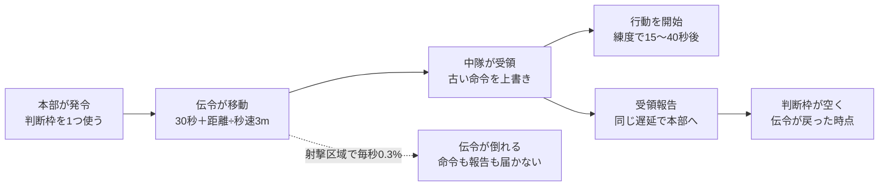
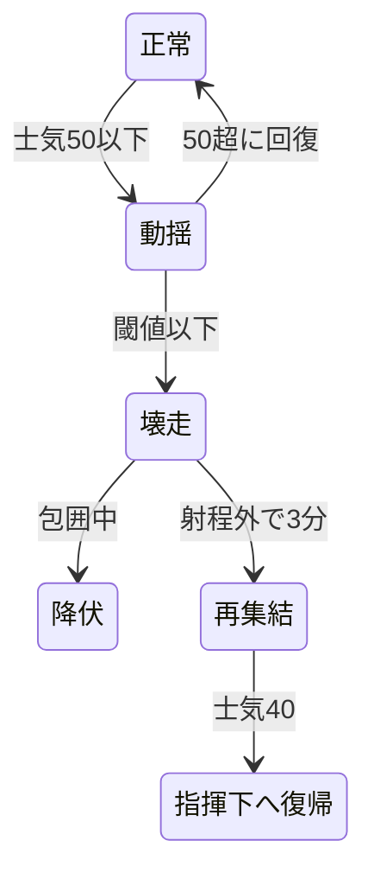

# 大隊指揮RTS プロトタイプ仕様書

2026-10-16 時点のスナップショット。原本は claude.ai 上の「大隊指揮RTS プロトタイプ仕様書」。リポジトリ内ではこのファイルを正とし、変更時は原本と同期する。

## 目的と検証仮説

この試作は、1会戦だけで「包囲と砲撃が気持ちよく決まるか」と「負けた理由が分かるか」を確かめる。絵、キャンペーン、物語は作らない。

| ID | 仮説 | 合格基準 | 測り方 |
| --- | --- | --- | --- |
| H1 | 包囲と砲撃の集中が気持ちよく決まる | テスター5人中4人以上が、印象に残った場面として包囲・壊走・砲撃のいずれかを自発的に挙げる | プレイ後の聞き取り（誘導しない質問） |
| H2 | 負けたとき、理由を理解できる | 敗北したテスターの8割以上が、戦闘ログ上の主因と一致する理由を説明できる | 敗北直後に「なぜ負けたと思うか」を聞き、ログと照合 |
| H3 | 同数の正面衝突は高くつき、側面攻撃は決着が速い | 300mで撃ち合う同数の正面衝突では、壊走までの時間の5パーセンタイルがゲーム内時間20分以上。同じ2対1でも、側面攻撃は正面攻撃の半分以下の時間で壊走させ、攻撃側の損害も小さい | 自動対戦のバッチ実行（各100回以上、分布で判定） |
| H4 | 命令の遅延が「読み」を生む | テスターの半数以上が、遅延を見越して早めに命令を出す行動を取る。「理不尽」という感想が半数未満 | 命令ログ（発令時刻と状況）と聞き取り |

H3は人間のテストの前に自動対戦で満たす。H1が2回の調整でも合格しない場合は、戦闘解決の設計を見直す。

## スコープ

試作は「1マップ・1会戦・自軍4中隊＋砲兵1、敵は同等」に限る。

| 含める | 含めない |
| --- | --- |
| 一時停止できるリアルタイムと倍速（×1、×2、×4） | キャンペーン、章構成、上層部の評価 |
| 中隊の向き・士気・拘束・壊走・包囲判定 | 作戦層（会戦の前の移動・補給線） |
| 伝令の遅延、判断枠、通信途絶と自律行動 | 戦訓・装備到着・支援枠などの成長要素 |
| 砲兵（観測、要請から着弾、弾薬、地形荒廃） | 対砲兵戦、航空、戦車 |
| 霧と報告（遅延・誤差） | 練度の消耗と補充 |
| 練度（3段階、個別に設定） | 立ち絵・会話・ボイス（立ち絵は頭文字の丸で代用） |
| 敵AI（方針3つ、評価と方針転換） | 敵指揮官の性格、敵の目標推定 |
| 作戦目標「奪取」「遅滞」の2種 | その他の作戦目標、途中の任務変更 |
| 無線ログ、戦闘詳報（敗因の表示） | セーブ・ロード、設定画面、音 |
| 自動対戦（AI同士、ヘッドレスのバッチ実行） | マルチプレイ |

## 技術方針

Unity 6.3 LTS（C#）で作る。戦闘シミュレーションは Unity に依存しない純粋な C# で書き、画面と切り離す。

- **シミュレーション層**：固定刻み（1刻み＝ゲーム内時間0.5秒）。乱数はシード固定で再現性を持つ
- **表示層**：Unity はシミュレーションの状態を読んで描くだけ。2D、軍隊符号と図形
- **入力層**：プレイヤーの命令も敵AIの命令も、同じ「命令オブジェクト」として渡す。AI 同士の対戦がそのまま成立する
- **パラメータ**：数値はすべて JSON に外出しする
- **ログ**：全イベントを JSON Lines で記録。戦闘詳報、H2 の照合、H3 の集計はこのログから作る
- **テスト**：シミュレーション層は EditMode テストで検証。自動対戦のバッチもテストランナーから実行
- **版管理**：Git タグで工程を区切る
- **独立性**：このリポジトリは他のプロジェクトのコードに依存せず、単独で成立させる

## 時間と命令系統

命令は伝令で運ばれ、距離に応じて遅れて届く。一時停止中に出した命令も例外ではなく、再開後に同じ遅延を経て届く。



伝令が倒れた場合、本部には「受領報告が来ない」という形でしか伝わらない。判断枠は発令から一定時間（初期値：往復予定時間の1.5倍）で強制的に空く。

### 時間

- ゲーム内時間で全てを定義する。×1 は「現実1秒＝ゲーム内時間4秒」、×2、×4 はその倍
- いつでも一時停止できる。停止中も命令の作成と地図の確認はできる
- 試作の会戦はゲーム内時間60〜90分を想定（×1 で現実15〜23分）

### 命令

命令は「目標と意図」で与える。経路や射撃目標の細部は中隊が決める。

| 命令 | 内容 |
| --- | --- |
| 前進 | 指定地点へ移動。接敵したら交戦しつつ前進を続ける |
| 攻撃 | 指定した敵中隊に接近して交戦する。向きを指定できる（側面に回り込む経路を中隊が探す） |
| 保持 | 現在地または指定地点を守る。向きを指定する |
| 拘束 | 敵を射撃で釘付けにする。前進も後退もしない |
| 後退 | 指定地点へ下がる。交戦中なら「離脱」のルールが適用される |
| 陣地構築 | 指定した地点へ移動して塹壕を掘る（地点を指定しなければその場で）。10分で完成。掘りかけでも段階的に効果 |
| 砲撃要請 | 砲兵の節を参照 |

### 伝令の遅延

- 到着までの時間＝準備30秒＋距離÷伝令の速度（秒速3m）。例：600mなら約230秒
- 伝令は大隊本部から中隊の現在位置へ向かう。中隊が動けば追いかける
- 敵の射撃が届く区域を通ると、伝令が倒れることがある（通過1秒あたり0.3%、初期値）
- 届いた命令は中隊から「受領」の報告が同じ遅延で本部に戻る
- 新しい命令は古い命令を上書きする。届くまでは古い命令で動き続ける

### 判断枠

同時に送り出せる伝令は3人まで。伝令が本部に戻るまで枠は空かない。

### 通信途絶と自律行動

- 伝令が倒れる、またはシナリオのイベントで、特定の中隊との連絡が途絶える
- 最後の命令を受けてから5分以上が経ち、状況が大きく変わった場合（敵の出現、士気の低下、隣の中隊の壊走など）、中隊は中隊長の性格で自律行動を始める
- 自律行動は無線ログに「（独断）」として記録される

## マップと地形

マップは3km×2km。部隊の位置は連続座標（メートル）で持ち、地形は50m四方の格子（60×40マス）で引く。

| 地形 | 移動 | 被弾（損害倍率） | 視界 |
| --- | --- | --- | --- |
| 平地 | ×1.0 | ×1.0 | 通す |
| 森林 | ×0.5 | ×0.6 | 内部は100mまで。外からは縁の部隊だけ見える |
| 村落 | ×0.7 | ×0.5 | 内部は150mまで |
| 塹壕（構築済み） | ×0.8 | ×0.3 | 通す |
| 砲撃痕 | ×0.6 | ×0.9 | 通す |
| 川 | 橋と浅瀬のみ通行可（浅瀬は×0.3） | — | 通す |

- **高さ**：各マスに標高。稜線は視線を遮る。標高10mごとに視界+10%
- **視界**：基本800m。射程（歩兵の有効射程400m）より遠くが見える
- **移動速度**：平地で歩兵中隊は秒速1.2m。交戦中は×0.5
- **経路探索**：地形の移動コストと敵の射程内に入るコストを足した A*。射程コストの重みは中隊長の性格で変わる

## ユニット

最小単位は中隊（歩兵150名、正面幅200m×奥行50mの矩形）。兵力と士気の数値だけを持つ。砲兵は地図外にいる。

### 属性

| 属性 | 値 | 説明 |
| --- | --- | --- |
| 兵力 | 0〜150 | 射撃力に比例する |
| 士気 | 0〜100 | 壊走の閾値を下回ると壊走する |
| 練度 | 新兵／通常／古参 | 下の表 |
| 向き | 角度 | 正面±60°、側面60〜120°、背面120°以上 |
| 状態 | 下の状態遷移 | 命令の受け付けと能力が変わる |
| 中隊長 | 性格 | 自律行動と命令の解釈 |

### 練度

| 項目 | 新兵 | 通常 | 古参 |
| --- | --- | --- | --- |
| 壊走の閾値（士気） | 35 | 25 | 15 |
| 射撃効率 | ×0.85 | ×1.0 | ×1.2 |
| 士気の減りやすさ | ×1.2 | ×1.0 | ×0.8 |
| 士気の回復速度 | ×0.7 | ×1.0 | ×1.3 |
| 命令を受けてから動き出すまで | 40秒 | 25秒 | 15秒 |
| 報告の位置誤差 | ±150m | ±100m | ±60m |

### 状態



壊走した中隊は、逃げ場があれば再集結して戻ってくるが、包囲中なら降伏して失われる。拘束（敵が150m以内から射撃）は正常・動揺に重なる状態で、後退に離脱ルールが掛かる。

| 状態 | 条件 | 振る舞い |
| --- | --- | --- |
| 正常 | 士気50超 | 命令どおりに動く |
| 拘束 | 敵が150m以内から射撃している | 後退は離脱ルール。移動×0.5 |
| 動揺 | 士気が閾値超、50以下 | 射撃×0.7。前進・攻撃の命令を拒む（保持になる） |
| 壊走 | 士気が閾値以下 | 命令を受け付けず、敵から離れる方向へ逃げる。追撃されると損害×2。隣接する味方の士気を一度だけ−10 |
| 再集結 | 壊走後、敵の射程外で3分経過 | 士気が40まで回復したら指揮下に戻る。その後の状態は士気で決まる（40なら動揺）。兵力はそのまま |

### 離脱

拘束中の後退は、開始時に士気−10、後退中は敵からの被弾×1.3。

### 中隊長の性格

性格は「命令の解釈」と「自律行動」の2箇所にだけ効く。能力値の補正は持たせない。

| 性格 | 命令の解釈 | 自律行動（通信途絶時） |
| --- | --- | --- |
| 慎重 | 射程に入る経路を強く避ける。士気60未満で前進を止めて保持に変える | 近くの遮蔽物まで下がって保持する |
| 冷静 | 命令どおり | 最後の命令を続行する。届かない本部に報告を送り続ける |
| 猪突 | 敵が動揺・壊走したら追撃する。経路は最短を選ぶ | 最も近い敵に攻撃をかける |
| 機敏 | 側面に回れる経路があればそちらを選ぶ | 敵の側面を狙える位置へ移動する |

## 戦闘解決

勝敗は損害より士気で決まる。以下の初期値は自動対戦の簡易モデル（`docs/reference/combat_reference.py`、各300回）で検算済み。

### 射撃（損害）

各中隊は目標を1つ選んで撃つ（P0 詳細の目標選択を参照）。0.5秒ごとに期待値を計算し、ポアソン乱数で実際の損害を決める。

```
λ = k × N_shooter × f_quality × f_range × f_terrain × f_aspect × f_state × Δt
```

| 係数 | 初期値 |
| --- | --- |
| k（兵士1人・1分あたりの殺傷） | 0.0133（同数の中隊が平地で撃ち合うと、毎分約2名ずつ倒れる） |
| f_range | 150m以内 1.3、400mまで 1.0、それ以上は撃たない |
| f_terrain | 地形の表の被弾倍率 |
| f_aspect | 正面 1.0、側面 1.5、背面 2.0（狙われた側から見た角度） |
| f_state | 動揺 0.7、正面の弧の外の敵への射撃 0.5、砲撃で制圧中 0.5 |

### 士気

| 要因 | 士気の変化 |
| --- | --- |
| 損害 | 初期兵力の1%を失うごとに−1.5（側面からの損害は×2、背面は×3） |
| 被弾中 | 毎分−0.5 |
| 初めて側面／背面を撃たれた | 一度だけ−10／−15 |
| 包囲 | 判明時に一度だけ−15、以後毎分−3（塹壕・村では半分） |
| 隣接する味方の壊走 | 一度だけ−10 |
| 射程外で休む | 毎分+1（練度の回復倍率を掛ける。上限70） |

減り幅には練度の「士気の減りやすさ」を掛ける。

### 包囲

包囲は「逃げ道があるか」で判定する。士気50以下になった中隊は、5秒ごとに退路を見積もる。16方位それぞれについて、壊走の速さ（秒速1.8m）で500m逃げる間に、400m以内の敵すべてから背面を撃たれ続けたら何割を失うかを、射撃の基本の式（k・兵力・距離倍率・背面倍率）で見積もる。射手の動揺や非正面の補正、接近戦の倍率は入れない（P1 では視線が通る敵だけを数える）。

- どの方位でも2割以上を失う見込みなら包囲。判明した瞬間に一度だけ士気−15（絶望）、以後毎分−3
- 塹壕・村の中では毎分の低下を半分にする（籠城）
- 壊走する中隊は、見積もり損害が最も少ない方位へ逃げる

包囲中に壊走した中隊は降伏して盤上から消える。正面と背面から撃たれていても、側面に逃げ道があれば包囲にはならない。しきい値の2割は、四方を囲まれた場合（約30%）とそれ以外（15%以下）の間に置いた値で、16〜29%のどこに置いても判定は変わらない。将来は練度や性格でしきい値を変える余地がある（試作では一律）。

### 接近戦

50m以内では、距離倍率を 2.0 に置き換える（150m以内の 1.3 とは重ねない）。その射撃による損害から生じる士気の減少は×1.5。塹壕にいる側は被弾倍率を保つ。接近戦は決着が速く高くつく場面として扱い、H3 の対象外（H3 は300mでの撃ち合いで測る）。

### 開けた場所を進む部隊の被弾（P1b の調整候補）

今の規則では、開けた場所を立って進む中隊も、伏せて撃ち合う中隊と同じ倍率で撃たれる。そのため300mから50mまで詰める約3.5分の損害は数名で済み、横に広い戦列で突撃すると、塹壕の守備を側面から巻き込んで安く勝ててしまう（概算シミュレーションのステージ2「総員突撃」が勝率100%・損害7%）。300mの撃ち合いでは、塹壕の守備は3対1でもほとんど崩れないので、問題は詰める間の損害だけにある。

候補：平地・砲撃痕・橋・浅瀬・塹壕のマスを移動中の中隊は被弾×2（初期値の案。塹壕を越えて進む兵も身をさらす）。パラメータは `terrain.moving_open_damage_mult`（初期値 1.0 ＝無効。P1b で切り替えて試す）。森・村・死角を通る接近と、制圧射撃で守備の射撃を落としてから詰める動きに意味が出る。P1a には入れず、P1b で実際に突撃してみてから値を決める。それでも安ければ、機関銃を P3 と同じ時期に検討する。

### 検算結果

通常練度の中隊（各150名）、平地、300m。時間はゲーム内時間。正解値は `docs/reference/reference_results.json`。

| 対戦 | 壊走まで（中央値） | 壊走まで（5〜95%） | 敗者の損害 | 勝者の損害 |
| --- | --- | --- | --- | --- |
| S1 1対1 正面 | 35.4分 | 28.0〜40.9分 | 約34% | 約34% |
| S2 2対1 正面＋正面 | 17.7分 | 14.3〜20.7分 | 45% | 17% |
| S3 2対1 正面＋側面 | 7.9分 | 6.1〜10.1分 | 26% | 8% |
| S4 2対1 正面＋背面 | 4.1分 | 3.0〜5.9分 | 17% | 5% |
| S5 古参対通常 正面 | 30.0分 | 24.2〜40.7分 | 40% | 30% |
| S6 4対1 四方を囲まれる | 1.3分（300回すべて降伏） | 0.8〜2.0分 | 11% | 2% |

正解値はリファレンス実装 v3（包囲を「逃げ道があるか」で判定し、S6 を追加）の出力。v2 では「2方向から撃たれたら包囲」だったため、S3・S4 は包囲による降伏で早く決着していた。v3 では側面に逃げ道があるため包囲にならず、壊走まで少し長くなる。

- H3 の基準を満たす。側面攻撃は同じ兵力差の正面攻撃の半分以下（約0.45倍）の時間で決着する
- 古参は通常に正面でほぼ確実に勝つが、自分も約3割を失う
- 簡易モデルは移動・地形・接近戦を含まない

## 砲兵

砲兵は強いが、見えている場所にしか撃てず、遅れて着弾し、弾は20分ぶんしかない。

### 編成と弾薬

- 野砲中隊1個（4門）。地図外の自軍後方、射程は地図全域
- 弾薬160発。射撃中は毎分8発（合計20分分）。補給はない

### 要請から着弾まで

1. プレイヤーが地点と射撃時間（1／3／5分）を指定する
2. 要請できるのは、敵の報告位置から200m以内、または会戦前に登録した計画射撃点（最大3箇所）
3. 本部から砲兵へは電話で30秒（判断枠は使わない）
4. 射撃準備に90秒。計画射撃点なら30秒
5. 初弾の誤差は100m。目標を直接見ている味方中隊がいれば1分後に30mになる。計画射撃点は最初から30m

### 効果

着弾半径100mの円に入った中隊は、敵味方を問わず効果を受ける（友軍誤射あり）。

| 対象の地形 | 損害（毎分、兵力比） | 士気（毎分、損害分を含む） | 通常練度が壊走するまで |
| --- | --- | --- | --- |
| 平地 | 6.0% | −15 | 約5分 |
| 森林 | 3.6% | −9.4 | 約8分 |
| 塹壕 | 1.8% | −4.7 | 約16分 |

- **制圧**：砲撃中と終了後1分間、対象の射撃効率は×0.5
- **地形荒廃**：同じマスに累計3分以上着弾すると「砲撃痕」（移動×0.6）
- 敵にも同じ規模の砲兵。対砲兵戦は対象外

## 霧と報告

地図に出る敵は「最後に報告された敵」。味方の位置は試作では正確に表示（味方も報告で表示する設定を検証用に用意）。

### 発見

- 各中隊は視界内の敵中隊を発見する。森林・村落の中の敵は、中の視界距離まで近づくか、敵が発砲すると発見できる
- 報告は命令と同じ伝令の遅延で本部に届く
- 接敵中の中隊は2分ごとに続報を送る。報告の伝令は判断枠を使わない

### 報告の中身

| 項目 | 内容 |
| --- | --- |
| 位置 | 実際の位置に練度に応じた誤差（±60〜150m） |
| 規模 | 小／中／大の3段階。新兵は20%で1段階間違える |
| 向きと動き | 静止／移動中と8方位 |
| 時刻 | 観測時刻。地図に「何分前の情報か」を表示 |
| 自部隊の状況 | 兵力・士気の大まかな状態、残弾、「包囲された」などの異変 |

### 表示ルール

- 敵の駒は報告位置に置き、誤差の範囲を薄い円で示す
- 報告から5分を過ぎた駒は薄く表示し、10分で「?」に変わる
- 同じ敵かどうかの紐付けは本部の推定。同じ敵が2つに見えることもある
- 戦闘詳報では、実際の敵の動きを報告と重ねて表示する

## 敵AI（最小版）

敵の大隊長AIは60秒ごとに状況を評価し、3つの方針から一つを選ぶ。評価には敵自身の報告だけを使う。

### 方針

| 方針 | 攻撃側のとき | 防御側のとき |
| --- | --- | --- |
| 火力戦 | 散開して前進し、接敵したら拘束して砲撃を要請 | 前線に兵力を密に置き、来た敵を砲撃と射撃で叩く |
| 縦深防御 | 前進を止め、進んだ線で陣地を築いて敵の逆襲を待つ | 前線は1中隊。主力は600m後方、突破してきた敵を逆襲 |
| 機動 | 1中隊で正面を拘束し、別の中隊で敵の側面へ迂回 | 予備を動かし、敵の攻撃部隊の側面を突く |

### 評価指標

| 指標 | 計算 | 点数が上がる方針 |
| --- | --- | --- |
| 砲撃による損害の割合 | 直近5分の自軍損害のうち砲撃によるもの | 縦深防御、機動 |
| 砲撃の費用対効果 | 自軍砲弾1発あたりの敵損害（報告ベース） | 高ければ火力戦、低ければ機動 |
| 側面の脅威 | 側面・背面に敵が報告されている自軍中隊の数 | 縦深防御 |
| 目標の進捗 | 作戦目標の達成度と残り時間 | 遅れていれば火力戦か機動 |
| 自軍の士気 | 全中隊の平均 | 低ければ縦深防御 |

### 方針転換のルール

- 新しい方針の点数が現在の方針を 0.2 以上上回る状態が3回連続（3分）続いたら転換
- 転換後の配置への命令も敵の伝令で運ばれる
- 転換は敵の動きとしてプレイヤーの報告に現れる
- 全ての点数、評価の内訳、転換をログに残す

各指標の重みは JSON で調整する。初期値は P4 で自動対戦で決める。

## 試作シナリオ

1枚の地図で、攻守を入れ替えた2つのシナリオ。地名は仮。

### 地図（3km×2km）

- 西端が自軍、東端が敵の初期配置
- 中央東寄りに稜線と村落（リーデル村）。稜線が西からの視界を遮る
- 北側に帯状の森。側面への迂回路
- 南側を東西に川。橋が1本、上流に浅瀬が1箇所
- 中央は開けた平地

### 兵力

| 陣営 | 編成 |
| --- | --- |
| 自軍 | 歩兵中隊4（第1 慎重・通常、第2 冷静・通常、第3 猪突・古参、第4 機敏・通常）＋野砲中隊1 |
| 敵 | シナリオごと。練度は全て通常、野砲中隊1 |

### シナリオA：奪取

| 項目 | 内容 |
| --- | --- |
| 任務 | リーデル村を奪取し、90分の時点で確保していること |
| 敵 | ステージ1：歩兵中隊3。稜線の頂上の塹壕に1、村に1、村の後方に予備1（頂上の塹壕からは目の前の斜面が死角）。ステージ2：歩兵中隊3。西斜面の塹壕に2（相互に支援）、村に予備1 |
| 狙い | ステージ1は、地形を読めば死角を通って正面から肉薄できる（教える面）。ステージ2は死角がなく、両翼包囲のような機動が要る（ひねる面）。どちらも予備（R3）は、攻撃側が守備の中心に近づくとその側面へ逆襲する（台本）。R1・R2 は向きを変えずに保持する（本格的な敵AIは P4） |

### シナリオB：遅滞

| 項目 | 内容 |
| --- | --- |
| 任務 | 60分の間、敵に橋を確保させない。土地は譲ってよい |
| 自軍 | 村落と稜線に配置した状態で開始（塹壕なし） |
| 敵 | 歩兵中隊6。東から攻めてくる |
| 狙い | 弾力的に下がる、橋の手前で粘るなど、攻撃とは違う考え方が必要になるかを確かめる |

### 共通イベント

- 開始から20分で、第3中隊（猪突）との連絡が10分間途絶える
- 会戦前に計画射撃点を3箇所まで登録できる

### 勝敗と評価

勝敗は任務の達成で決める。損害率・弾薬消費・所要時間・降伏させた敵中隊の数を戦闘詳報に表示する。

バランスの目安：自動対戦で、正面攻撃しかしない攻撃側AIの勝率が30〜40%、側面攻撃を使うAIは60%以上。

## UIと戦闘詳報

画面は「大隊指揮RTS 画面イメージ」（claude.ai 上のモック）の構成を使う。立ち絵は頭文字の丸で代用し、軍隊符号と図形だけで描く。

### 画面構成

| 領域 | 内容 |
| --- | --- |
| 上部バー | 作戦名、経過時間、一時停止と倍速、判断枠の残り、砲弾の残り、通信途絶などの警告 |
| 左パネル | 中隊長の一覧（性格、兵力・士気バー、現在の任務、状態） |
| 中央 | 地図。味方の駒、報告された敵の駒（誤差円と経過時間）、霧、砲撃範囲、移動中の伝令 |
| 右パネル | 選択中の中隊の詳細と命令ボタン |
| 下部 | 無線ログ（報告、受領、独断、通信途絶） |

### 操作

- 中隊を選ぶ→命令を選ぶ→地図をクリック。ドラッグで向きを指定
- 命令を出すと伝令の点線と到着予定時刻を表示。届くまで「発令済み・未着」の印
- スペースで一時停止、1〜4で中隊選択

### 戦闘詳報

- **地図の再生**：「本部が見ていた敵」と「実際の敵」を重ねて見る
- **敗因の要約**：壊走・降伏した中隊ごとに、士気を削った要因の内訳を表示。解決策は書かない
- **決定的な瞬間**：壊走の連鎖、包囲の成立、敵の方針転換、届かなかった命令を時刻付きで並べる
- **命令の遅れ**：発令から到着までの時間と、到着時に状況が変わっていた命令
- 文面の例：「第2中隊、T+41分に壊走。士気低下の62%は北側面からの射撃。北の森の敵は T+33分に報告されていた」

## 検証計画と調整パラメータ

工程は6段階。各段階の終わりで完了基準を確認し、Git タグを打ってから次に進む。

| 段階 | タグ | 内容 | 完了基準 |
| --- | --- | --- | --- |
| P0 | proto-p0-sim | 戦闘シミュレーションの核（射撃、士気、状態、向き、包囲、ログ）。画面なし | EditMode テストで検算結果を±15%以内で再現。同じシードで同じ結果 |
| P1 | proto-p1-map | 地図・地形・視線・経路探索、Unity での表示、遅延なしの命令 | シナリオAの地図で4中隊を動かして敵と戦える |
| P2 | proto-p2-c2 | 伝令の遅延、判断枠、通信途絶と自律行動、霧と報告 | 一時停止中の命令が再開後に遅れて届く。4性格がそれぞれの自律行動を取る |
| P3 | proto-p3-arty | 砲兵 | 砲兵の効果表を±15%で再現。友軍誤射が起きる |
| P4 | proto-p4-ai | 敵AI、自動対戦のバッチ、シナリオA・B | H3 を満たす。シナリオAの勝率が目安の範囲 |
| P5 | proto-p5-aar | 戦闘詳報、仕上げ、プレイテスト | テスター5人で H1・H2・H4 を判定 |

### プレイテストの進め方

- 1人あたりシナリオAを最大2回、時間があればBを1回。説明は操作方法だけ
- プレイ中は口を出さず、ログを収集
- 終了後の質問：「一番印象に残った場面は？」「なぜ勝った／負けたと思う？」「理不尽だと感じた瞬間は？」「もう一回やりたい？」

### 主な調整パラメータ

- 射撃：k、距離倍率、側面／背面の損害倍率
- 士気：損害あたりの減少、側面／背面の倍率と初回ショック、包囲の毎分減少、壊走の閾値
- 命令：伝令の準備時間と速度、判断枠の数、伝令が倒れる確率、自律行動までの時間
- 砲兵：弾数、準備時間、誤差、地形ごとの効果
- 敵AI：評価の間隔、指標の重み、転換の条件（0.2、3回）
- 時間：×1 の圧縮率、シナリオの制限時間

### 未決事項

- 接近戦の数値は未検算。P0 で自動対戦に加えて決める
- 味方の位置も報告で表示する設定を標準にするかは、プレイテストで決める
- ×1 の圧縮率が快適かどうかは P2 で触って決める

## P0 詳細仕様

P0 の曖昧な点をここで確定させる。検算の正解値は `docs/reference/reference_results.json`。

### リポジトリと構成

- 新しいリポジトリ。他プロジェクトのコードには依存しない。仕様書もリポジトリ内に置き単独で完結させる
- シミュレーションは Unity に依存しないアセンブリ（noEngineReferences）に分ける
- 乱数は自前の PCG32。ポアソン乱数は Knuth 法（1刻みのλは0.1未満）
- 兵力は整数、その他は double

### 幾何

- 中隊の位置は矩形の中心。射程・距離は中心間で測る
- 向きの判定：対象の向きベクトルと「対象の中心→射手の中心」の角度が60°以内なら正面、120°以内なら側面、それ以外は背面

### 1刻み（0.5秒）の処理順

1. 命令の到着処理（P0 ではスクリプトから直接与える）
2. 移動と旋回
3. 目標選択（刻みの開始時点の状態で）
4. 損害と士気の計算（全中隊分を計算してから一括で適用する同時解決）
5. 状態遷移
6. ログ出力

### 目標選択

- 射程400m以内の敵のうち、自分の正面の弧（±60°）にいる最も近い敵。いなければそれ以外で最も近い敵（射撃効率×0.5）
- 距離が同じなら ID の小さい方。1中隊につき目標1つ
- 壊走中の中隊は撃たないが、目標にはなる（追撃のため）

### 士気の細則

- 「被弾中」＝その刻みに1中隊以上から狙われている（損害0でも該当）
- 回復：壊走しておらず、60秒間狙われていなければ毎分+1×練度倍率。上限70
- 下限0。要因ごと（正面、側面、背面、砲撃、包囲、隣の壊走、被弾中、回復）の累計を中隊ごとに保持

### 包囲の細則

- 見積もりは士気50以下の中隊だけが行い、5秒ごとに更新する（それ以外の中隊は包囲されていない扱い）
- 16方位は東（x軸の正）から反時計回りに22.5度刻み（向きの定義と同じ）。各方位について1秒刻みで500m先まで進み、その時点で400m以内にいる壊走していない敵すべてから、背面（損害×2、150m以内はさらに×1.3）を撃たれると仮定して、失う兵の割合の期待値を積算する。敵は動かないものとし、乱数は使わない
- 全方位の見積もりが0.20以上なら包囲。包囲でなくなったら毎分の低下も止まる。絶望（−15）は会戦中に一度だけ
- 最も損害の少ない方位を、壊走時の逃げる方向として保持する。同点の方位が複数あれば、600m以内の敵の中心の平均位置から最も遠ざかる方位を選ぶ。600m以内に敵がいなければ、壊走中もその場に止まる。見積もりは同時解決とし、刻みの開始時点の状態で行う

### 壊走・追撃・再集結

- 壊走した中隊は、退路の見積もりで損害が最も少ない方位へ秒速1.8m。地図の端で会戦から離脱（降伏とは別に記録）
- 包囲中に壊走したら即座に降伏し、盤上から取り除く。降伏の判定は壊走した瞬間の包囲状態だけで行い、逃走中は判定しない
- 追撃：壊走中の中隊を150m以内から射撃している敵がいれば、その射撃の損害は×2
- 再集結：400m以内に敵がいない状態が3分続いたら再集結を始める。士気40で指揮下に戻る
- 壊走の連鎖：壊走した中隊から300m以内の味方中隊に、一度だけ士気−10

### 移動（P0 の最小限）

- 平地のみ。指定地点へ直線で秒速1.2m（拘束中×0.5）
- 旋回は毎秒6°。移動中は進行方向を向き、到着後に指定の向きへ旋回。ただし後退の命令では、向きを変えずに後ろ向きに下がる（速度×0.6）。敵に背を向けて逃げるのは壊走だけ。拘束中の後退は×0.5と×0.6を重ねる（秒速0.36m。プレイテストで厳しすぎないか確認する調整項目）。P1 では、目的地が背後の弧にあるときだけ後退として扱い、それ以外は通常の移動にする
- 経路探索・地形・視界は P1。P0 では全ての敵が見えている

### パラメータとログ

- パラメータは `sim_params.json` 1ファイル（初期値は `docs/reference/sim_params.initial.json`）
- ログは JSON Lines。共通フィールドは `t`（ゲーム内秒）、`type`、`unit`
- イベント：`state_change`、`rout`、`surrender`、`rally`、`left_battle`、`encircled_start`、`encircled_end`、`first_flank_hit`、`first_rear_hit`、`unit_snapshot`（10秒ごと。兵力、士気、位置、向き、状態、目標、要因別の士気累計）

### 検算テスト

- 配置は `combat_reference.py` のシナリオ S1〜S6 と同一。全部隊はその場で保持
- シード 1〜300 で各300回。最初の壊走または60分で打ち切る
- 合格：壊走までの時間の中央値と、各中隊の平均損害率が、いずれも正解値の±15%以内（損害率が0の中隊は対象外）
- 再現性：同じシードを2回回して、ログの SHA256 が一致すること

## P1 詳細仕様

P1 の目標は「シナリオAで4中隊を動かし、北から村の側面を突けるか試せる」状態。ここで初めて H1（包囲の手応え）に触れる。視線や経路探索は、そのための最小限の正しさで止める。

### 分割

| 部分 | タグ | 内容 | 場所 |
| --- | --- | --- | --- |
| P1a | proto-p1a-terrain | 地図データの読み込み、地形の効果、視線、経路探索、命令の挙動（攻撃・後退の向き）、陣地構築 | Sim アセンブリのみ。クラウドで可 |
| P1b | proto-p1b-view | 地図と部隊の描画、命令の入力、一時停止と倍速、UI | Unity。ローカル |

### 地図データ

- ファイルは `maps/scenario_a1.json`（ステージ1）と `maps/scenario_a2.json`（ステージ2）。生成スクリプトと検証用のリファレンス実装は `docs/reference/map/`
- 座標は x が東、y が北、原点は南西の角。1マス50m、60×40マス
- `terrain` と `elevation` は北の行から並べる（テキストで読んだときに北が上）
- 地形の文字：`.` 平地、`F` 森林、`V` 村落、`W` 川、`B` 橋、`S` 浅瀬、`T` 塹壕。会戦中に変わる層（構築した塹壕、砲撃痕 `C`）は別の配列で持つ
- 初期配置、村や橋のマス、制限時間も同じファイルに入れる

### 視線

地形の表の「視界」の列は、以下の規則で置き換える。正解値は `docs/reference/map/map_reference_results_a1.json` と `_a2.json`。

- 観測者と目標の中心を結ぶ線分を10m刻みで調べる（両端を除く）
- 標高はマス中心の値を双線形補間する。目の高さは地面+2m。地面が線より高ければ遮られる（稜線）
- 森林・村落のマスを通る距離を、森林 1.0、村落 0.5 の重みで足す（観測者と目標がいるマスは除く）。合計が100mを超えたら遮られる。森の中は約100m、村の中は約200m先まで見える
- 視界距離は800m×（1＋0.1×高低差÷10m）。高い側から見るときだけ伸びる
- P1 では、射撃の目標は視線が通っている敵に限る。霧と報告は P2（P1 の画面では全ての敵を表示する）

### 地形の効果

- 移動倍率と被弾倍率は、中隊の中心があるマスで決める
- 塹壕の被弾倍率（0.3）は、その刻みに動いていない中隊にだけ効く
- 陣地構築：動かずに10分で完成。途中は進捗に応じて被弾倍率が地形の値から0.3へ近づく。動くと進捗は失われる。完成すると、中隊の正面幅にあたるマス（中心と左右2マスずつ）が塹壕になり、他の中隊も使える
- 川は橋と浅瀬以外通れない

### 経路探索

- 8近傍の A*。斜め移動で通れないマスの角を切らない
- 1歩のコスト＝距離÷移動倍率＋脅威の重み×露出×50。露出は「そのマスが400m以内の敵から見えている」なら1
- 脅威の重み：慎重 3.0、冷静 1.0、機敏 1.0、猪突 0.3
- 露出の地図は10秒ごとに作り直す。経路は命令を受けたときと、30秒ごとに引き直す
- 経路はマス中心の点列。一直線に並ぶ点は間引く
- 味方中隊の中心どうしは200m以上離れる（重なりの禁止。中隊の正面の幅と同じで、横に並べても矩形が重ならない）。初期配置もこの規則を満たす。目的地が近すぎる場合は隣へずらし、移動中に近づきすぎたら互いに押し離す。敵中隊との衝突は扱わない
- P2 で霧が入ったら、「敵に見られている」ことにも小さなコストを足す。北の森が迂回路として意味を持つのは、その時点から

### 命令の挙動

| 命令 | 挙動 |
| --- | --- |
| 前進 | 経路探索で移動。移動中は進行方向を向き、到着後に指定の向きへ旋回 |
| 攻撃 | 目標の敵中隊と方向（正面／側面／背面）を指定。発起点は「敵の中心からその方向へ250m」。側面は経路コストの小さい側を選ぶ。方向を指定しなければ正面。ただし機敏は、側面の経路コストが正面の1.5倍以下なら側面を選ぶ。発起点は30秒ごとに敵の位置で更新し、到着したら敵に正面を向けて撃ち続ける |
| 後退 | 目的地が背後の弧（向きから120°より後ろ）にあるときだけ、向きを変えずに後ろ向きに下がる（×0.6）。それ以外は前進と同じ扱い |
| 保持 | その場で指定の向きを保つ |
| 拘束 | その場で、目標の敵に正面を向けて撃ち続ける |
| 陣地構築 | 目的地があれば前進と同じく移動し、着いて向きを変え終えたら掘り始める（移動中は進捗が増えない）。目的地がなければその場で。掘り方は地形の効果を参照 |

### P1a の設計で確定した細則

- 退路の見積もりの視線は、敵ごとに「400m以内の各マスの中心が見えるか」を10秒ごとに作り、見積もりの点はその点のマスで引く（最大約35mのずれは許容）
- 退路の見積もりで、川に突き当たる方位は逃げられない（以降の損害を最大とみなす）。地図の外へ出られる方位は、出るまでの損害で打ち切る
- 壊走中に川に突き当たったら、その刻みは動かない。5秒後の見積もりで方位が変わる
- 陣地構築で塹壕になるのは、平地と砲撃痕のマスだけ（中心と、向きを8方位に丸めて直交する左右2マスずつ）。森・村・川・橋・浅瀬は変えない
- 押し離しは、両方が動いていれば半分ずつ、片方だけが動いていれば動いている方だけを押す。止まっている中隊（陣地の中隊）は押されない。押した先が通れないマスなら押さない
- 予備隊の台本で動く R3 の経路の脅威の重みは 0（敵の性格は P4）
- シナリオAの勝ち：90分の時点で村のマスに指揮下の青の中隊がいて、村の中心（1975, 1000）から250m以内に指揮下の赤の中隊がいない。または赤が全て盤上から消え、青が残っている
- S1〜S6 は、原点を（−1200, −850）にずらした全て平地の地図（60×40マス）の上で回す
- 経路探索は、止まっている指揮下の味方の中心から200m未満のマスに入らない。避けると届かない場合は、避けずに引き直す（味方の陣地を突っ切らない）
- 攻撃の目標が指揮下でなくなったら（壊走・再集結・降伏・離脱）、攻撃をやめてその場で保持する。追撃は P2 以降
- 崩れた敵は、射程外で3分経つと再集結して戻ってくる。崩しただけでは勝ちにならず、村に入って確保する（戦果の拡張と占領はプレイヤーの仕事）
- P1 の数値は `sim_params.json` の `terrain`・`sight`・`map_rules` に置く（初期値は `docs/reference/sim_params.initial.json`）

### Sim と表示の境界（P1b）

- Sim は刻みごとの状態を読み取り専用で公開する。表示は直前の2刻みの間を補間して滑らかに描く
- 時間：ゲーム内秒＝現実の秒×4×倍速。たまった分だけ刻みを進める（1フレーム最大16刻み）。一時停止中は進めない
- 入力は命令オブジェクトを作って Sim に渡すだけ。P1 では即時に適用し、伝令の遅延は P2 で入れる
- 攻撃で「側面」を選ぶとき、敵の駒の端（どちらかの側面寄り）をクリックすればその側面、中央をクリックすれば経路コストの小さい側（Sim が選ぶ）
- 会戦は90分で止めて判定する。それより前に止めるのは、赤か青が全て盤上から消えたとき。終了後は時間を止め、地図と駒は見られるようにする
- 描画：地形は色分けしたマスと等高線。味方は青の矩形（歩兵は×印）、敵は橙。向き、兵力、士気、状態を駒に表示する。細部は P1b の設計で決める

### P1d：行動の規則（確定）

P1b・P1c のプレイテストで出た論点。プレイヤーは大隊長で、執行の細部は中隊長（性格）に任せる、という切り分けで整理する。

| 大隊長（プレイヤー）が決める | 中隊長（性格）が決める |
| --- | --- |
| どこを何のために（攻撃・拘束・確保・後退・陣地構築）、攻める方向と側 | 経路、撃つ目標 |
| 時機と連携、予備の投入、砲兵（P3） | 脇から撃たれたときに向き直るか |
| 追撃の許可と限界、後退の決断 | 許された範囲で追うか、取った後どちらを向いて固めるか |

**1. 攻撃の側と追いかけっこ**
- 発起点に着く前：側をプレイヤーが指定していない攻撃（指定なしの側面、予備隊の台本）は、経路を引き直すたびに今の位置から経路コストの安い側を選び直す。揺れ止めとして、もう一方の側のコストが今の側の 0.8 倍未満のときだけ替える。プレイヤーが端をクリックして側を指定した攻撃は、指定を守る
- 発起点に着いて撃ち始めたら、目標の中心から見た自分の方角（地図上の方角）を固定する。以後は目標が向きを変えても回り込み直さない。目標の中心が 50m 以上動いたときだけ、固定した方角の 250m の点へ動き直す
- 経緯：P1c で R3 が逆襲を決めた時点の目標の向きで側を選び、目標が90°向きを変えた後も反対側へ回り込もうとして、目標の中をすり抜けた

**2. 敵の中隊とは重ならない**
- 動いている中隊は、自分の矩形と敵の矩形（降伏した中隊を除く）の隙間が 10m 未満になる手前で止まる。そこは接近戦の距離なので、そのまま撃ち合いになる
- 経路探索は、敵の矩形から、自分の矩形の半対角（約 103m）＋隙間 10m（約 113m）以内のマスを通れないものとして避ける（露出の地図と同じく10秒ごとに作り直す。P1e.1 で半幅から半対角に広げた）。敵どうしの間が約 226m 未満なら、その間は通れない。避けると届かない場合は、届くところまでの経路を引く
- 壊走中の中隊も敵をすり抜けられない（ふさがれたら止まる）。退路の見積もりでも、敵の矩形に掛かる方位はそこで逃げられない（川と同じ扱い）

**3. 拘束**
- 目標の中心から、今いる方角へ 125m の点まで詰めて止まり、目標に正面を向けて撃ち続ける。突入しない
- 目標が動いたら、30秒ごとに同じ方角の 125m の点へ動き直す
- 攻撃との違い：攻撃は方向（正面・側面・背面）を選んで回り込み、250m から撃つ。拘束は回り込まずに詰め、150m 以内の足止めの効果を出す

**4. 追撃の許可**
- 攻撃の命令に「目標が崩れたら」を持たせる：確保（初期値）／追撃可
- 目標が指揮下でなくなったとき（壊走・降伏・離脱）：
  - 確保：その場で保持して固める。向きは、400m 以内に指揮下の敵がいれば最も近いその敵の方、いなければ目標が逃げていった方角（敵の側）
  - 追撃可：性格で決める。慎重は確保と同じ。冷静は 400m 以内に指揮下の敵がいなければ追い、追っている間に 400m 以内に指揮下の敵が現れたら止まって確保に移る。機敏は追う。猪突は追い、限界を 1.5 倍まで越える
- 追う動き：壊走中の目標から 100m の距離を保って追い、撃ち続ける（150m 以内なので追撃の ×2 が掛かる）。追撃を始めた地点から 600m（限界）を越えたら止まって確保に移る。目標が降伏・離脱・再集結したら止まって確保に移る
- 自動一時停止に「攻撃の目標が崩れた」を足す

**5. 向き直り（中隊長の判断）**
- 対象：保持・陣地構築・攻撃で発起点に着いた後・前進や後退で目的地に着いた後の中隊（動いている中隊と、拘束の命令中の中隊は対象外）。動揺中の拘束は詰めずに、その場で目標を向いて撃つ
- 側面か背面から指揮下の敵に撃たれたら、次の条件で撃ってきた敵へ向き直る。向き直り始めるまでの遅れは練度の命令開始の遅れ（新兵40秒・通常25秒・古参15秒）
  - 慎重・冷静：正面の弧（±60°）の 400m 以内に、視線の通る指揮下の敵がいなければ
  - 機敏：正面の弧の 150m 以内に指揮下の敵がいなければ（正面で足止めされていなければ）
  - 猪突：向き直らない
- 待ちの間に、正面の弧に敵が現れるか、10秒間側面・背面から撃たれなければ、待ちを取り消す。向き直った向きは新しい命令が出るまで保つ
- 正面を拘束された中隊は向き直れないので、拘束と迂回が報われる

**6. 壊走中の味方のすり抜け**
- 壊走中の中隊は味方の中隊をすり抜けられる。重なっている間、逃げる側の速さは ×0.5
- すり抜けられた指揮下の味方は、その壊走中の中隊ごとに一度だけ士気 −5、30秒間射撃効率 ×0.5（隊形の乱れ）。前線の真後ろに支援を重ねない配置の教訓が出る

**7. 逃げる方位の揺れ止め**
- 壊走中の方位は、新しい最小の方位の見積もり損害が、今の方位の見積もり損害より 0.05 以上小さいときだけ替える
- P1b で壊走した中隊が右往左往した件は、原因を調べて報告する（揺れ止めで直るか、別の原因か）

### P1e：行動と命令の改善（確定）

P1d のプレイテストと通し実行で見つかった点。番号は依頼文と対応する。

**1. 隊列の超越（味方の中を抜ける）**
- 止まっている指揮下の味方の中心から200m未満のマスは「通れない」ではなく、経路のコストを高くする（距離のコスト ×3）
- 味方の中を抜けている間（その味方の中心から200m未満で、残りの経路がその味方の200mの圏を通るか、矩形が重なっている間）は、抜ける側とその味方の間で押し離しをしない。抜ける側の速さは、矩形が重なっている間だけ ×0.5
- 経緯：予備の R3 が、止まっている味方（R1・R2）を避ける規則と敵を避ける規則の組み合わせで通り道をふさがれ、逆襲に出られなかった

**2. 動くときの向き**
- 接敵中（400m 以内に視線の通る指揮下の敵がいる）の移動は、向きを変えずに動く。目的地への方角が正面の弧（±60°）なら前進（今の速さ）、横（60〜120°）なら横歩き（×0.5）、背後の弧なら後ろ向き（×0.6、今の後退と同じ）。到着後の向きの指定があれば、着いてから向きを変える
- 接敵していないときは、経路の曲がり角で止まらず、旋回しながら進む。旋回している間（向きと進む方角の差が 20° を超える間）は速さ ×0.7
- 攻撃・拘束で発起点へ向かう動きも同じ規則に従う。壊走は対象外（今の規則のまま）
- 後退は、接敵中は上のとおり（背後の弧なら後ろ向き ×0.6）。接敵していなければ、振り向いて曲がりながら普通の速さで下がる（敵が見えないところで後ろ向きに歩く理由はない。撃たれうる距離にいれば接敵中なので、背を見せることはない）
- 接敵した瞬間の向きを保つ（敵の方へ向き直らない）。脇から撃たれたときの向き直りは P1d の規則に任せる
- 経緯：横へ動く中隊がわざわざ敵に側面や背面を向けて大きな損害を受けた。曲がり角ごとに止まって向きを変えていた

**3. 拘束の距離**
- 拘束の命令に「遠い／近い」を持たせる。初期は遠い
  - 遠い：目標の中心から今いる方角へ 350m の点（すでに 350m 以内ならその場）。足止めの効果はないが、慎重・冷静の敵の向き直りは防げる
  - 近い：125m（P1d と同じ）。足止めの効果がある
- 経緯：塹壕の正面 125m に詰めた拘束の中隊が、迂回が着く前に壊走した

**4. 攻撃の方向は「攻める方角」で指定する**
- 地図の方角での指定（主な操作）：敵の駒から外へドラッグして方角を示す。目標の中心からその方角の 250m の点が発起点。正面・側面・背面は結果として決まる
- 範囲での指定（F・S・B）：正面は目標の向きの ±60°、側面は 60〜120°（左右とも）、背面は 120〜180°。今いる方角がすでにその範囲に入っていれば、今の方角から攻める。入っていなければ、範囲の中で今の方角に最も近い方角（範囲の端から 10° 内側）から攻める
- 指定なし：今いる方角から攻める。機敏は、今より良い向き（正面＜側面＜背面）の範囲だけを候補にし、経路コストが今の方角の 1.5 倍以下の候補のうち最も良い向きを選ぶ
- 予備隊の台本は「側面の範囲」で攻撃する（逆襲は突出した敵の側面を突くもの、という台本の意図を保つ。範囲なので、目標が向きを変えれば選び直す）
- 発起点に着く前：範囲・指定なしの攻撃は、経路を引き直すたびに上の規則で方角を選び直す（P1d の揺れ止め 0.8 倍はそのまま）。地図の方角で指定した攻撃は、指定を守る
- 着いた後：P1d のとおり方角を固定する
- P1c の「駒の端をクリックして側を選ぶ」操作は、地図の方角での指定に置き換える
- 経緯：敵の後ろから指定なしで攻撃すると正面へ回り込んだ。西を向いた敵に南南西から側面を指定すると、すでに側面の範囲にいるのに真南の位置まで回り込んだ

**5. 命令の下見と経路の表示**
- 命令を選んで地図にカーソルを重ねた時点（攻撃なら方角をドラッグしている間も）で、目的地（発起点）と経路を薄く表示する
- 命令を出した直後に経路を引き、一時停止中でも経路と目的地を表示する
- 経緯：一時停止中に出した命令の経路が表示されなかった

**6. 通し実行に「拘束＋迂回」を足す**
- 両ステージに、1個中隊が遠い拘束で正面を押さえ、別の中隊が側面の範囲から攻撃し、残りが続く作戦を足す。近い拘束版も回す
- 向き直りの規則のもとでこの作戦が報われるか（他の作戦より勝率・損害が良いか）を確かめる

**P1e.1：止まった中隊の動き直しと作戦の続き**
- 前進・後退・攻撃・拘束で、敵の矩形の手前（隙間 10m）で止められた中隊は「着いた」扱いにしない。30秒ごとに経路を引き直し続け、道が空けば進む
- 経路で敵を避ける範囲を、自分の矩形の半対角（約 103m）＋10m に広げる（横歩きで角が引っかかるのを減らす）
- 接敵中の横歩き（×0.5）は今のまま。敵の前を横切る迂回は高くつき、迂回は接敵圏の外で回すのが正しい、という教訓として残す
- 通し実行の「拘束＋迂回」に続きを足す：R1 が指揮下でなくなったら、B3 と B4 は村の中心へ前進する（条件つきの命令）
- P1e の通し実行で分かったこと：遠い拘束＋迂回は両ステージとも損害・崩れ方で全作戦中最良。近い拘束は、ステージ1では死角の中から撃つので R1 に見えず向き直られ、ステージ2では拘束役が先に崩れる

**P1e.2**
- 敵に阻まれて止まっている中隊も、向き直り（P1d の5）の対象にする。止まって撃たれている点は保持と同じため
- 通し実行の「拘束＋迂回」：R1 が指揮下でなくなったら、拘束役も含む指揮下の青の全中隊が村の中心へ前進する
- 通し実行の作戦は回帰の指標として扱い、勝率を合わせるための作戦の作り込みはしない。面白さと妥当さは人が遊んで確かめる

### P1f：地形の高さを読む（確定）

P1e のプレイテストで、等高線から立体が読めず「なぜか目の前の敵を撃たない」「なぜか視線が通らない」になった。規則は正しく、見せ方が足りない。2D の地図のまま、紙の地図の技法で立体と死角を読めるようにする（3D 化はしない。見た目の方向性を決める段で改めて考える）。

- ア：陰影（北西から光を当てたヒルシェード）
- イ：高さで平地の色を明暗に変える。25m おきの太い等高線に標高の数字
- ウ：上部バーにカーソルの地点の標高
- エ：撃たない理由：射程内に指揮下の敵がいるのに視線が通らない中隊から、その敵へ点線と理由（稜線・森・村）。理由は Sim の視線の判定の結果を使う
- オ：断面図：視線確認ツール（L）で2点を指定すると、その間の地形の断面と目の高さの視線、遮られる区間、森・村の帯を小窓に出す

### P1g：目標が見えないときの中隊長の判断（確定）

P1e のプレイで、指示された位置に着いた中隊が、稜線で目の前の敵が見えずに黙って立っていた（P1f の断面図で、攻撃の発起点 250m がステージ1の R1 の死角に入ることが確かめられた）。命令の目的に沿って、中隊長が見える所を探すようにする。

- 攻撃：発起点に着いても目標が見えない（視線が通らない、または射程外）なら、固定した方角に沿って目標へ詰め、見えて射程内になった所で止まって撃つ。攻撃の目的は目標と交戦することで、発起点はその手段にすぎない。死角から詰めると至近距離の撃ち合いになる（死角を使った肉薄。ステージ1の狙いどおり）
- 拘束：拘束点で目標が見えなければ、目標からの距離を保ったまま、今の方角の左右 ±45° の範囲で見える位置を探し、今の位置に最も近い見える位置へ移る。範囲になければ、見えるまで今の方角に沿って詰める（近い拘束の 125m より近くへは詰めない。それでも見えなければ 125m で止まり、接触の規則に任せる）
- 保持・陣地構築・前進・後退：見えない敵には何もしない（命令どおり）。撃てない理由の点線（P1f のエ）で気付かせる
- 接触中は視線を問わない：互いの矩形の隙間が接近戦の距離（50m）以内なら、視線の判定をせずに撃ち合える（接近戦の倍率が掛かる）。白兵戦の距離で「見えない」はない
- 接近戦の倍率（×2.0、士気 ×1.5）も、中心どうしの距離ではなく矩形の隙間 50m 以内で掛ける（P1g.1）。中心どうしの距離で測ると、P1d の「隙間 10m の手前で止まる」規則のもとでは向かい合った中隊の中心は 60m より近づけず、接近戦がほぼ起きなくなっていたため。150m の ×1.3 と射程 400m は中心どうしの距離のまま
- 見える位置を探して動いたことは、ログと下部の出来事の欄に出す（例：「第2中隊：目標が見えないため前進」）。自動一時停止には足さない
- 見える位置の判定と探索は 30秒ごと（経路の引き直しと同じ時機）。撃てる位置に着いた後に目標が見えなくなったら（目標が動いた等）、また探す

### P1 の完了

P1g.1 のプレイテストで致命的な問題がないことを確かめ、P1 を閉じる（タグ `proto-p1-map`）。P1 の完了基準（シナリオAで4中隊を動かして敵と戦える）は満たした。細かな違和感は今後「P1 の残り」としてここに溜め、P2 以降の該当する段で拾う。

## P2 詳細仕様

P2 の目標は H4（命令の遅れが読み合いを生む）に触れること。命令が即座に届く P1 から、伝令で遅れて届き、敵の姿も報告でしか分からない状態へ移る。大きいので3つに分ける。

| 段階 | タグ | 内容 |
| --- | --- | --- |
| P2a | proto-p2a-runners | 伝令の遅延、判断枠、伝令の喪失、予備隊の台本への遅延 |
| P2b | proto-p2b-orders | 段階つき命令、信号弾、到着予定、伝令の経路 |
| P2c | proto-p2c-autonomy | 中隊長の自律行動（持ち場、裁量、性格の独断） |
| P2c.2 | proto-p2c2-requests | 意見具申（中隊から本部への伝令。報告・要請・宣言、通信途絶） |
| P2d | proto-p2d-fog | 霧と報告（敵は報告された姿だけが見える） |

### P2a：伝令（確定）

仕様の「時間と命令系統」の伝令の遅延・判断枠を実装する。数値は既存の節のとおり。

**本部の位置**
- 青の大隊本部：(100, 800)。赤の本部：(2700, 1000)。両ステージ共通。試作では動かない
- 地図ファイルは変えず、シナリオの定義（C#）に持たせる。本部は地図上に軍隊符号（旗の印）で描く

**伝令**
- 発令すると、伝令が本部を出る。準備30秒の後、秒速3mで中隊の今の位置へまっすぐ向かう（中隊が動けば追いかける）。地形と経路探索は使わない（試作の簡略化）
- 中隊に着いたら命令を渡す。中隊は練度の遅れ（新兵40秒・通常25秒・古参15秒）の後に動き始める。届くまでは古い命令で動き続ける
- 受領の報告：伝令はそのまま本部へ戻る（同じ速さ）。本部に着いた時点で「受領」が分かり、判断枠が空く
- 伝令の喪失：伝令が、指揮下の敵の射程内で視線が通るマス（P1a の露出の地図と同じもの。その陣営から見た敵の射界）を通る間、1秒あたり0.3%で倒れる。倒れた伝令の命令は届かず、受領も来ない
- 本部は伝令が倒れたことを知らない。発令から「往復の予定時間の1.5倍」が過ぎても受領が来なければ、判断枠を強制的に空け、「受領報告なし」を出来事の欄に出す
- 一時停止中に出した命令も、再開後に同じ遅延を経て届く

**判断枠**
- 同時に外に出ている伝令は3人まで。3人とも出ていれば、新しい命令は出せない（ボタンを押せないようにし、理由を出す）
- 同じ中隊への命令を、届く前に出し直すことはできる（新しい伝令が出る）。上書きは出した順で決める。古い命令の伝令が新しい命令の伝令より後に着いたら、その古い命令は捨てる
- 会戦開始前の命令：会戦が始まる前（時刻0のまま、まだ一度も時間を進めていない間）に出した命令は、伝令を使わずに届き、判断枠も使わない（会戦の前に作戦を伝え終えている）。時間が進み始めた後の命令は全て伝令で届く。上部バーに「開始前：命令は即座に届く」と出す

**予備隊の台本（赤）**
- 赤の予備の逆襲も、赤の本部から伝令で届く。引き金の条件を満たした時点で赤の本部が発令し、伝令が R3 に着いてから動き出す。赤の伝令も射界で倒れうる
- 赤の判断枠は試作では数えない（台本の命令は1つだけのため）

**表示**
- 伝令は地図上の小さな点で、本部と中隊を結ぶ点線の上を動く。行き（命令）と帰り（受領）で色を変える
- 発令済みで届いていない命令は、中隊の駒と左パネルに「未着」の印と到着予定（ゲーム内の残り秒）を出す。経路の下見（P1e）は「未着」の間も薄く出す
- 上部バーに判断枠（○○○。出ている数だけ塗る）
- 出来事の欄：「第2中隊 命令受領」「第2中隊 受領報告なし（伝令が倒れた可能性）」
- 自動一時停止に「受領報告なし」を足す

**検算**
- 本部から 600m の中隊への命令が、230秒（30＋600÷3）で届き、さらに練度の遅れの後に動き出す
- 受領は往復で約 430秒後に本部に届き、判断枠が空く
- 射界を 100秒通る伝令の生存率は 0.997^100 ≒ 74%

### P2b：段階つき命令と信号弾（確定）

P2a のプレイで、命令を1つしか持てないため「丘を北から迂回して村へ向かえ」の後は何もしない、という声が出た。実際の作戦命令は「第1段：〜、第2段：〜」と段階に分けて書く。1人の伝令が段階を含んだ命令書を運べば判断枠も節約でき、よく練った計画ほど伝令の負担が少なくなる（H4 の核心）。敵の様子への反応（崩れたら追う、脇から撃たれたら向き直る）は、今どおり中隊長の性格と追撃の許可に任せ、条件には入れない（プレイヤーをプログラマーにしない）。

**段階つき命令**
- 1つの命令書に最大3段階。各段階は今の命令の1つ（前進・後退・保持・拘束・攻撃・陣地構築。攻撃の方角・追撃の許可、拘束の距離も今どおり）
- 経由地は段階で表す（例：第1段「丘の北へ前進」、第2段「村の中心へ前進」、第3段「保持（東向き）」）
- 第2段・第3段には「移る条件」を1つ付ける：
  - 完了したら：前の段階が終わったら（前進・後退は着いたら、攻撃は目標が指揮下でなくなったら、陣地構築は完成したら。保持と拘束は終わらないので、この条件は選べない）
  - 時刻：ゲーム内の時刻（T+mm:ss）になったら
  - 信号弾：指定の色の信号弾が上がったら
- 移る時点で、練度の遅れ（新兵40秒・通常25秒・古参15秒）の後に次の段階を始める
- 最後の段階が終わった後は今と同じ（その場で保持。P2c で中隊長の自律行動を足す）
- 命令書は1人の伝令がまとめて運ぶ。新しい命令書が届いたら、古い命令書は段階ごと全て置き換える
- 会戦開始前の命令（伝令なしで即座に届く）も段階つきにできる

**命令書の確認と修正**
- 中隊ごとに、命令書を次の3つに分けて見せる（6つの枠を別々に持つのではなく、命令書が本部→伝令→中隊と渡っていく。それぞれ最大3段）
  - 起案中：本部の机の上にある。自由に直せる。1中隊に1枚
  - 送付中：伝令が運んでいる。読むだけ（取り消せない）
  - 実行中：中隊が持っている。読むだけ。今の段を強調し、済んだ段は薄く
- 起案は白紙からでも、実行中の命令書の写し（今の段から後）からでも始められる
- 起案中にできること：段の追加・削除・上下の入れ替え、各段の命令と移る条件の変更、起案の破棄
  - 第1段には移る条件がない。入れ替えで第1段になった段の条件は外し、第1段から下がった段には条件を付けるよう求める
  - 選べない組み合わせ（保持・拘束の後に「完了したら」、条件のない第2段・第3段）には印を出し、直すまで発令できない
- 発令：「発令」ボタン（またはキー）を押したときに初めて出す。命令を選んだだけでは出さない（1段だけの命令も同じ）。発令で判断枠を1つ使い、伝令の準備（30秒）が始まる
- 伝令が出発するまで（準備中）は、その命令書を直す・取り消すことができる
  - 直しても準備の残り時間は数え直さない
  - 取り消すと判断枠が空き、伝令は出ない
- 伝令が出発した後は取り消せない。直したければ新しい命令書を送る（後から出したほうが優先。P2a どおり）
- 一時停止中も同じ。時間が止まっているので準備も進まず、出発前に何度でも直せる
- 会戦開始前の命令は、会戦が始まるまで自由に直せる
- 経緯：P2a のプレイで、一時停止中に間違った命令を選ぶと取り消せなかった

**信号弾**
- 赤・緑・白の3色。各色は会戦中に1回だけ打ち上げられる
- 本部から打ち上げ、全ての味方の中隊に即座に届く（試作では距離・視界・天候を問わない）。判断枠も使わない
- 信号弾の意味は、前もって命令書の「移る条件」に書いておいた分だけ。信号弾で新しい命令は出せない
- 赤の側には効果なし（敵にも見えるが、意味は分からない）
- 将来：シナリオの進行に合わせて解禁する（信号弾、電話線など、指揮の手段が増えることを成長にする）

**到着予定**
- 命令の下見（P1e）に、各段階の到着予定時刻（経路の長さ÷その時の速さの概算。地形の移動倍率を含む）を「約 T+mm:ss」で添える。時刻の条件を決めるときの目安にする

**伝令の経路**
- 伝令は今のまっすぐではなく、経路探索で進む。脅威の重みは慎重と同じ 3.0（自分の陣営から見た敵の射界をできるだけ避ける）。川は橋と浅瀬だけを渡る。地形の移動倍率を掛ける
- 中隊が動くので、10秒ごとに経路を引き直す
- 到着予定と受領の強制開放（往復予定の 1.5 倍）の見積もりも、経路の長さで出す
- 経緯：P2a のプレイで、伝令が途上の敵陣をまっすぐ突っ切っていた

**設計の段で決めたこと（P2b 実装時）**
- 信号弾は上がったことが残る。段の条件を調べ始めた時点で、その色がすでに上がっていればすぐ満たす（遅れて届いた命令書も合図に合わせられる）
- 信号弾の打ち上げは、ボタン・キー（F9 赤・F10 緑・F11 白）とも3秒以内の2回押し（取り返しがつかないため）
- 攻撃の「完了」は目標が指揮下でなくなった刻み。練度の遅れの間だけ確保／追撃し、次の段へ移る
- 陣地構築の「完了」は陣地が完成した時。動揺で前進が保持に変わった場合は完了しない（時刻・信号弾なら移る）
- 段の条件は指揮下の中隊だけが調べる。壊走・再集結から指揮下に戻ったら、今の段から調べ直す
- 伝令は敵の駒の矩形に重なるマスを通らない（射界は重み 3.0 のコストで避ける。P1d の敵の周りの規則は使わない）
- 準備中の命令書の［直す］は、書きかけの起案がある間は押せない。宛先は変えられない
- 会戦開始前の命令書は、会戦が始まるまで伝令なし・判断枠なしで直して出し直せる
- パラメータ：`orders.max_stages` 3、`runners.path_threat_weight` 3.0、`runners.replan_sec` 10

**P2b.1：プレイの声を受けた直し（確定）**
- 段の自動追加：起案中の段に命令を書き込んだら、その下に空の段を1つ自動で足す（3段まで）。［段を足す］は残す
  - 自動で足した段の条件の初めの値は今と同じ（前の段が終わる命令なら「完了したら」、保持・拘束の後は未設定）
- 空の段は無視して発令できる：命令の入っていない段は、条件が未設定でも発令を止めない。発令の時点で、命令の入っていない段は命令書から落とす（間に空の段があれば詰める）
  - 命令の入った段に条件がない、保持・拘束の後に「完了したら」、は今どおり発令できない
- 命令待ちの表示：命令書がない中隊と、最後の段を終えた中隊（「完了」の判定は段の表と同じ。保持・拘束は終わらないので当たらない）を「命令待ち」とする
  - 駒に「命令待ち」の印（灰色の小さな札など）、左パネルに「命令待ち」、出来事の欄に「B2 命令を終えた（命令待ち）」
  - 会戦開始前は全ての中隊が命令待ちで始まる。送付中の命令書がある中隊は、命令待ちの印に「未着」を添える
  - P2c の中隊長の自律行動は、この「命令待ち」の状態を起点にする
- 使った色の信号弾：上がった色は、新しく起案する段の条件に選べない（ボタンを無効にし、「使用済み」と出す）。起案中・準備中の命令書に使った色の条件が残っていれば、その段に印を出す（上がったことが残るため、届いた瞬間に満たしてしまう）。直すまで発令・差し替えはできない
- 信号弾の撃ち直しは入れない。各色1回のまま（合図の意味がぶれないように。色や回数が増えるのはシナリオの進行で解禁する）
- 経緯：P2b のプレイで、段を毎回足す手間と、命令の済んだ中隊が分からないことが挙がった

### P2b.2：壊走・動揺と命令書（確定）

P2b.1 のプレイで2つ挙がった。壊走中・再集結中の中隊には伝令を出せない。再集結した中隊が、命令書に前進が残っているのに動かない。

後者の原因：再集結を終えて指揮下に戻る刻みに、今の命令を保持に置き換えているが、命令書は前進の段のまま残る。そのため画面の表示と実際の動きが食い違い、「完了したら」は二度と満たされず、士気が戻っても再開しない。動揺で前進が保持に変わる場合（P0 からの規則）も同じ作りで、正常に戻っても前進を再開しない。

**壊走中・再集結中の中隊への命令**
- 壊走中・再集結中の中隊にも命令書を送れる（判断枠を使う。伝令は今どおり中隊を追いかけて渡す）
- 中隊は届いた命令書を預かる。指揮下に戻ったら、練度の遅れの後に第1段を始める（預かっている間に別の命令書が届いたら置き換える。出した順で新しい方を優先、は今どおり）
- 受領の報告は、渡した時点で今どおり本部へ戻る
- 表示：駒と左パネルに「命令書を預かり中（再集結後に開始）」

**壊走したときの命令書**
- 壊走した時点で、実行中の命令書は中断する（残りの段も含めて捨てる）。出来事の欄に「B2 壊走（命令書は中断）」
- 再集結を終えて指揮下に戻ったら、預かっている命令書があればそれを始める。なければ命令待ち（その場で保持）
- 理由：士気の低い再集結直後の中隊が、古い攻撃の計画を自分で再開するのは、プレイヤーの意図に反しやすい

**動揺で止まったときの命令書**
- 動揺で前進（目的地のある陣地構築の移動を含む）を止めた場合、命令書の今の段は捨てずに「動揺で停止中」とする。その間はその場で保持（今どおり）
- 正常に戻ったら（士気50超）、練度の遅れの後に今の段の命令を同じ目的地で再開する
- 停止中の段に「完了したら」は満たされない。時刻・信号弾の条件は今どおり満たしうる（満たしたら次の段へ移る。次の段が前進・攻撃なら、動揺の間は今どおり拒まれて保持になり、それも「動揺で停止中」として扱う）
- 動揺中に始まる段が前進・攻撃で拒まれた場合も同じく「動揺で停止中」とし、正常に戻ったら始める
- 表示：駒と左パネル、命令書の今の段に「動揺で停止中」

### P2c：中隊長の自律行動（確定）

プレイヤーに「バカ！」と思われる判断は、結果が悪いことではなく、プレイヤーの意図を踏みにじった判断と、理由の分からない判断から生まれる。逆に、何もしていないように見える中隊長も同じくらい白ける（P1g の件）。

P2 の並びを分ける：**P2c 自律行動（今回）**、**P2c.2 意見具申**（中隊から本部への伝令）、P2d 霧と報告。P2c の間、宣言・報告は出来事の欄に即座に出す（仮）。P2c.2 で伝令に載せる。

**原則**
1. 命令の目的に従う：命令ごとに守るべきもの（持ち場）を決め、性格によらない自律行動は持ち場を壊さない
2. 性格によらない自律行動は、小さく元に戻せる動きだけ（向き直る、物陰へ寄る、浅い掩体を掘る、崩した敵の陣地に入る）
3. 性格の独断は、長所と短所が同じ性質の表と裏になるようにし、命令の「裁量」で律せる。律すると長所も消える
4. 判断には必ず理由を出す（駒と出来事の欄。助言はしない）
5. 何もしていないように見せない
6. 性格は能力値の補正を持たない（今どおり）。差は行動だけで出す

**持ち場**
- 中隊が今守っている地点：保持・陣地構築はその地点、前進・後退は着いた地点、攻撃は確保した地点、拘束は拘束点。命令待ちはそのときの位置
- 性格によらない自律行動（下の「全ての中隊長」）は、持ち場から 100m を出ない
- 独断（下の「性格の独断」）は、性格ごとの限度で止まる

**裁量（段ごとの新しい項目）**
- 任せる（初めの値）：性格の独断を許す
- 厳命：独断しない。命令の字面どおり
- 攻撃の「崩れたら：確保／追撃」（P1d）は命令の字面として残す。裁量は字面を越える独断を決める
- 初めの値を「任せる」にする理由：初めが「厳命」だと、性格の違いに気付かないまま遊び終えかねない

**全ての中隊長（裁量によらない。対象：指揮下で、動いていない中隊。命令待ち・保持・確保・着いた後・動揺で停止中を含む）**

| 場面 | 振る舞い | 初めの値 |
| --- | --- | --- |
| 撃てる目標がない | 危ない敵の方を向く（P2c.1 で直した。下の「P2c.1」の節が正） | 30秒・400m・600m |
| 開けた所で撃たれている | 持ち場から 100m 以内の物陰（森・村・塹壕、または浅い掩体）へ寄る。今の目標が見え続ける所を優先、次に被弾倍率の低い所、次に近い所。練度の遅れの後に動く | 開けた所（被弾倍率 1.0）で 30秒撃たれ続けた。被弾倍率が今の 0.7倍以下になる所だけ |
| 止まって静か | 浅い掩体を掘る。動くと失う。命令の陣地構築とは別（重ねない） | 120秒動かず、60秒撃たれていない。掘り始めて 300秒で被弾 ×0.6（陣地構築は 600秒で ×0.3） |
| 攻撃の目標を崩して確保した | 崩した敵がいた位置が塹壕・村で、確保した地点から 200m 以内なら、そこへ入って固める | 200m |

**性格の独断（裁量が「任せる」のとき）**

| 性格 | 性質 | 長所（独断） | 短所（同じ独断の裏） | 限度 | 厳命なら |
| --- | --- | --- | --- | --- | --- |
| 猪突 | 功を焦る | 「確保」でも目標が崩れたら追う。追撃が終わったら、400m 以内の動揺・壊走中の敵へ続けて攻めかかる（戦線を押し広げる）。前進・攻撃を拒むのは士気 40 以下（ほかは 50） | 持ち場を大きく離れ、戻らない | 持ち場から 900m（今の追撃の限界 600m×1.5 の値を使い直す）。その先では止まって命令待ち | 字面どおり |
| 機敏 | 機を見る | 止まっている間に、500m 以内の敵が別の味方に正面から撃たれていれば、その敵の側面の範囲（発起点 250m）へ自分で回り込んで攻める | 持ち場や連携から外れる | 経路 600m 以内、持ち場から 600m 以内。崩したらそこで確保（戻らない） | 字面どおり |
| 慎重 | 損害を嫌う | 撃たれると物陰を広く探し、損害を避ける。士気 60 未満で前進・攻撃を止める（今の表どおり）。「追撃」の字面でも追わない | 遅い。持ち場を離れて下がる | 物陰を探す範囲を持ち場から 200m に広げる（後ろ向きも可） | 字面どおり（50 で止まる。追撃も字面どおり） |
| 冷静 | 字面どおり | 当てになる | 突出した長所がない | — | 変わらない |

- 「追撃」の字面のときの限度：猪突は持ち場から 900m、機敏・冷静は今どおり（600m。冷静は 400m 以内に指揮下の敵がいれば止まる）、慎重は任せると追わない
- 独断の始まりに「宣言」を出す：「B1（猪突）独断で追撃」「B4（機敏）独断で側面へ」「B3（慎重）独断で後退（物陰へ）」
- 計算の根拠（追撃）：壊走は秒速 1.8m、追う側は 1.2m で、差は毎秒 0.6m 開く。100m から追い始めると、150m（追撃の ×2）を越えるのは約 83秒後（追う側は約 100m 進む）、射程 400m を越えるのは約 500秒後（約 600m 進む）。今の限界 600m は射程を外れる所と一致し、1.5倍の 900m まで追っても撃てない。そのため猪突の長所は、遠くまで追うことではなく、追撃の後に「続けて別の弱った敵へ攻めかかる」ことに置く

**表と性格の表**
- 「中隊長の性格」の表の「自律行動（通信途絶時）」の列は、この節で置き換える（通信途絶の場面は P2c.2 の意見具申とあわせて扱う）
- 追撃の規則（P1d の 4）は、上の「追撃」の字面のときの限度に読み替える

**表示**
- 命令書の各段に［任せる］［厳命］。駒と左パネルに性格を常に出す
- 自律行動・独断の理由を、駒の行動の印と出来事の欄に出す（「物陰へ（開けた所で被弾）」「浅い掩体を掘っている」「B1（猪突）独断で攻撃（B 動揺中の R2）」）
- 独断で動いている中隊は、印の色を変える（独断と分かるように）

**セカンドプラン（記録）**
- 調べた結果：本命は Sim の中に純 C# で書く効用 AI（候補の行動に点数を付けて選び、点数を押し上げた要素をそのまま理由に出せる）。Unity の Behavior パッケージやアセットストアの AI の多くは GameObject の上で動く前提で、純 C# の Sim には載せにくい。強化学習（ML-Agents）は理由を説明しにくく、P4 の敵 AI と抜け道探しに取っておく

### P2c.1：撃てる目標がないときの向きの直し（確定）

P2c の通し実行で、「撃てる目標がないときに最も近い既知の敵の方を向く」規則が、勝率を大きく下げていた（規則を止めると P2b.2 の値にほぼ戻る）。中身は2つ。

- 塹壕の R1 が、まだ撃てない遠くの回り込み役 B1 の方を先に向く。後から正面に来た拘束役 B2 と撃ち合い始めても、向きをそのまま保つ。そのため B2 に側面を撃たせ、B1 には正面を向けている
- 着いた B3 が、撃てない最も近い敵の方を向き、別の敵 R2 に背中を撃たれる（猪突は脇・背から撃たれても向き直らない）

「最も近い敵の方を向く」は、有能な中隊長の振る舞いとしても粗い。中隊長は、近い敵ではなく危ない敵の方を向き、すでに正面に敵がいれば向きを変えない。次のとおり直す。

**向く相手（上から順に、最初に当てはまったもの）**
1. 直近 30秒に自分を撃った敵（複数なら一番多く撃った敵）
2. 自分から視線の通る、400m 以内の指揮下の敵で、最も近いもの
3. 自分から視線の通る、600m 以内の指揮下の敵で、最も近いもの
4. いなければ今の向き

- 「陣営のどれかから見える敵」はやめ、**自分から見える敵**にする（P2d の霧の前でも、中隊長が自分で見ていないものには反応しない）

**向き直らない場合**
- 今の正面の弧（±60°）の 400m 以内に、自分から見える指揮下の敵がすでにいる（今向いている先を捨てない）

**撃てる目標ができたとき**
- 自律の向きを解き、命令の向きに戻す。その後の向きは、今どおり射撃の目標選び（正面の弧の敵を優先）と P1d の向き直り（脇・背から撃たれたとき）に任せる

**あわせて**
- 猪突の独断（確保でも追う・続けて攻める）が、通し実行で1度も出ていない（B3 に攻撃の命令がない）。通し実行に、B3 が「確保」の字面で攻撃する作戦を1つ足し、癖の出方を確かめる

**P2c.1.1：接触の距離の敵と「接敵中」（確定）**
- P2c.1 の通し実行で分かった食い違い：撃ち合いでは、隙間 50m 以内の接触の敵を視線を問わずに数える（P1g）。ところが、動くときに向きを保つ「接敵中」（P1e。400m 以内に視線の通る敵）の判定は視線だけを見ていて、接触の敵を数えていなかった。そのため、稜線の陰で接触の距離にいる拘束役 B2 が、見える位置を探して横へ動くときに進む方へ向きを変え、視線を問わず撃てる R1 に脇と背を撃たれていた
- 直し：「接敵中」の判定に、接触の距離（隙間 50m 以内）の指揮下の敵を含める（視線を問わない）。撃ち合いの規則と揃える
- 守る側が撃ってきた敵に正面を保つ、P2c.1 の向きの規則はそのまま

**P2c.1.2：「気付いている敵」の判定を揃える（確定）**
- P2c.1.1 の洗い出しで、視線だけで敵の有無を見ていて、接触の距離（隙間 50m 以内）の敵を数えていない判定が6つ見つかった
- 規則：中隊がその敵に「気付いている」とは、視線が通るか、接触の距離にいること（撃ち合いの規則と同じ。`SightForFire` と同じ判定を共通に使う）
- 揃えるもの：
  1. P1d の向き直りの「正面の弧が空いているか」（接触の距離の敵が正面にいれば、空いていない）
  2. P2c.1 の自律の向き（正面の弧の敵、向く相手）
  3. P2c の物陰の「今の目標が見え続ける所」（候補の地点から、視線が通るか接触の距離なら可）
  4. 露出の地図（敵の矩形から接触の距離のマスは、視線を問わず射界に数える。伝令の経路と中隊の経路の脅威に効く）
  5. 退路の見積もり（逃げる各刻みで、視線が通るか接触の距離の敵を、撃ってくる敵に数える）
- 揃えないもの：P1g の見える位置を探すときの候補の点。これは「視線が通る所」を探す動きで、接触の距離に入れば撃ち合いの規則で撃てる（攻撃は今どおり詰めて接触に任せる。拘束は 125m より近くへ詰めない）
- 結果（P2c.1.2 の報告）：効いたのはほぼ 1（P1d の正面の弧）だけ。冷静の R1 が、稜線の陰で正面にいる拘束役 B2 に気付くようになり、脇を撃つ回り込み役 B1 へ向き直らなくなった。ステージ1の近い拘束は 0.30→0.60（P2b.2 の 0.55 並み）で、「拘束して側面を突く」（H3）がまた成り立つ
- 3（物陰の候補）と 4（露出の地図の中隊の経路への効き）は、今の規則では効く場面がない（接触の距離のマスは、敵を避けるマス（約 113m）に必ず入るため）。4 は伝令の経路にだけ効く。判定は揃えたまま残す

**作戦目標（記録のみ。評価は V1 で入れる）**
- シナリオA の村は、南の川に架かる橋を押さえる交通の要衝と読む
- 青：第一目標＝村の奪取、第二目標＝塹壕の敵の排除。赤：村の死守（塹壕は村を守る外郭）
- 結果は両軍の目標の達成で評価する（勝ち負けを1つにしない）。塹壕を素通りして村を取れば「第一目標のみ達成」
- 迂回された塹壕の赤が村へ下がる・逆襲に出る判断は P4（敵AI）

### P2c.2：意見具申（確定）

中隊から本部へ、伝令で報告・要請・宣言を送る。決めるのはプレイヤー。届くまでに時間がかかることも読み合いになる（H4）。P2c の間は出来事の欄に即座に出していた宣言も、この段から伝令に載せる。

**中隊からの伝令**
- 中隊が本部へ1人を出す。準備 10秒、秒速 3m、経路・射界での喪失・川の渡り方は本部の伝令と同じ。片道（本部に着いたら終わり。中隊へは戻らない）
- 青の判断枠（本部の伝令 3人）は使わない
- 1つの中隊が同時に出せる伝令は2人まで。それを越える分は、送る前に捨てる（古い方を残す）
- 伝令が倒れたら、本部には何も届かない（本部は知らない。出来事の欄にも出さない）
- 赤の中隊は送らない（赤の本部の振る舞いは P4）
- 喪失の乱数は、戦闘の乱数とも本部の伝令とも別の流れから引く（通し実行の戦闘の結果を変えない）

**送るもの**

報告（知らせるだけ。返事は要らない）

| 種類 | 送る時 |
| --- | --- |
| 命令を終えた | 命令待ちになった時（P2b.1） |
| 目標崩壊 | 攻撃の目標が指揮下でなくなった時 |
| 敵発見 | 気付いている（P2c.1.2）指揮下の敵が 600m 以内に初めて入った時（その敵について一度だけ） |
| 損害大 | 前の「損害大」から、兵力の 20% を新たに失った時 |
| 攻撃頓挫 | 前進・攻撃の段が「動揺で停止中」になった時 |
| 隣の崩壊 | 300m 以内の味方が壊走した時 |
| 陣地完成 | 陣地構築を終えた時 |

要請（返事を待つ。返事がなくても困らない：返事がなければ持ち場を保つ）

| 種類 | 送る時 | 返事 |
| --- | --- | --- |
| 命令を請う | 命令待ちが 5分続いた時。以後 10分ごと | 新しい命令書 |
| 追撃の可否 | 攻撃の目標が崩れ、字面が「確保」で、独断で追わない時（冷静・慎重・機敏、または厳命の猪突） | ［許可］で、その目標への攻撃（崩れたら：追撃）の命令書を起案する |
| 後退の許可 | 動揺していて、かつ撃たれている時（慎重は士気 60 未満から） | ［許可］で、後退の命令書を起案する（行き先はプレイヤーが決める） |

宣言（独断を始めた時。P2c の宣言を、即座の表示から伝令に載せ替える）
- 「B1（猪突）追撃に移る」「B3（猪突）攻めかかる（動揺中の R2）」「B4（機敏）側面へ回る（R2）」「B1（慎重）物陰へ下がる」

**中身**
- 送った時点の中隊の様子を添える：「T+12:30 時点：兵力 82%・士気 55・動揺／位置／今の段」。届いた時には古いことがある
- 要請への返事は、命令書として本部の伝令で送る（判断枠を使う）。［許可］は命令書を起案の欄に作るだけで、発令はプレイヤーが押す（直してから出せる）
- 却下の返事はない（何も送らなければ、中隊は持ち場を保つ）

**送りすぎを防ぐ**
- 同じ中隊からの報告・要請は 60秒あけてまとめる（その間に起きたものは1人の伝令にまとめて載せる）
- 宣言は即座に送る（まとめの間隔を待たない）
- 同じ種類の要請は、状況が変わるまで繰り返さない（「命令を請う」の 10分ごとは除く）

**性格の差**
- 慎重：「後退の許可」を士気 60 未満から送る。「損害大」を 10% ごとに送る
- 冷静：表のとおり
- 猪突・機敏：独断できる場面では、要請ではなく宣言を送る（任せるのとき）。厳命のときは冷静と同じ

**表示**
- 本部に届いた時に、出来事の欄に出す：「[T+12:30 発] B2 目標崩壊。追撃の可否を問う」。要請は目立つ色
- 「具申の箱」（右パネルなど）：届いた要請の一覧。各行に［許可］と［消す］。古くなった要請（その後に新しい命令書を送った等）は薄くする
- 中隊の伝令の点と点線（本部の伝令と色を変える。例：中隊→本部は緑）
- 自動一時停止の選択肢に「要請が届いた」を足す（初めは切）
- P2c の、独断の宣言をその場で出す表示は、伝令が届いた時に出す形に置き換える。地図上の行動の印（独断中の橙など）は今どおり（霧は P2d）

**通信途絶**
- 本部の伝令が来ない間も、中隊は上の表のとおり送り続ける（届かなくても送る。冷静の「届かない本部に報告を送り続ける」）
- 本部の側は、ある中隊から最後に伝令が届いた時刻を左パネルに出す（「最後の報告 T+08:10」）。長く届かないことが、プレイヤーにとっての「通信途絶」の手がかりになる

### 検証の道具：作戦の探索（V1・V2。確定）

**目的**：与えられた規則・地図・敵の下で、強い作戦を機械に探させ、規則と地図の検討、開発側が意図した行動の検証に使う。とりわけ、**開発側が想定していない攻略法**（例：塹壕を無視して村を取る）を見つけることを一番の注文とする。

**答える問い（最初の版）**
1. 抜け道：今の規則で一番強い作戦は何か。それは意図した戦い方か
2. 狙いとのずれ：ステージ1は「死角からの肉薄」が上位か、ステージ2 の上位は何か。ずれていても、弱い守りのステージならそれ自体は問題ではない。問題にするのは「強い陣地が突撃だけで破れる」こと（「Battalion への課題」の物差し）
3. H4 が効いているか：伝令の遅れをなくした版と比べて、最適解と点が変わるか。段階つき命令・信号弾が最適解の中で使われるか
- 後から同じ道具で回す問い：難しさ（素直な作戦と最適解の差）、性格の釣り合い（任せる／厳命の使われ方）、規則を変えたときの最適解の動き

**想定外を見つけるための作りの原則**
- **探す手を型で縛らない**：作戦の「型」（正面・片翼・両翼など）を遺伝子にしない。プレイヤーが出せる命令そのもの（どの命令でも、地図のどの地点でも、どの方角・時刻でも）を組み合わせる。今の通し実行の作戦は、初めの集団に混ぜる種にとどめる
- **系統は結果から分ける**：作戦の系統（多様性を保つための軸）は、命令の中身ではなく**会戦で起きたこと**から取る（例：どの赤の中隊を崩したか、青がどこを通ったか、村を取った時刻）。「R1 と一度も撃ち合わずに村を取った」作戦が、ひとつの系統として自然に残る
- **点数を1つにまとめない**：第一目標・第二目標・損害・時間を別々の目的として扱い、どれかで優れる作戦を残す（1つの重み付きの点にすると、たとえば「塹壕の排除」の重みで素通りの作戦が埋もれる）。加えて「第一目標だけ」で探す回も設ける
- **期待との食い違いを出す**：開発側の期待を短い条件の一覧で書いておき（例：「村を取った作戦は塹壕の赤を崩している」「火力で抑えずに開けた所を正面から陣地へ進む作戦は、大損害か失敗になる」）、それに反する上位の作戦を一覧で報告する
- **運で勝った作戦を選ばない**：候補は数本のシードで評価し、残った作戦は多くのシード（50本など）で評価し直す

**限界（承知しておくこと）**
- 探せるのは会戦前に組める作戦（段階つき命令、信号弾の時刻、決まった時刻に送る追加の命令書）まで。状況を見て判断を変える作戦は表せない
- 赤は今の台本どおり受け身なので、「赤が受け身なこと」につけ込む解も見つかる。それ自体が P4 の宿題の一覧になる

**V1：作戦目標による評価**
- シナリオA の作戦目標（記録済み）を評価に入れる
  - 青の第一目標：村の奪取（今の勝ちの条件と同じ）
  - 青の第二目標：塹壕の敵の排除（塹壕に配置した赤の中隊が、90分の時点で全て指揮下にない、または盤上にいない）
  - 赤の目標：村の死守（青の第一目標の裏）
- 会戦の結果として、目標ごとの達成、両軍の損害、村を取った時刻、崩れた・降伏した中隊、撃ち合った組（どの青がどの赤と、いつ）、青の各中隊の通り道（30秒ごとの位置）を記録する
- 通し実行の表と Unity の会戦の終わりの画面に、目標ごとの達成を出す（勝ち負けを1つにしない）

**V2：作戦の探索**
- Unity の外で動く .NET のコンソールの道具（`tools/` の下）。ゲームの規則はコピーせず、Sim のソースと同じ `sim_params.json`・地図を参照する。ゲームの規則を直せば、探索の結果も自動でそれに従う（実験の値の変更は上書きの設定で渡す）
- 探し方：品質と多様性の探索（MAP-Elites など）を主にし、多目的の選び方を組み合わせる（詳細は設計で決める）
- 出力
  - 系統ごとの上位の作戦の一覧（命令書の要約、目標の達成率、損害、時間）
  - 期待との食い違いの一覧
  - 作戦を命令書のファイルに書き出し、Unity で読み込んで再生できるようにする
- 実験
  - 両ステージで、問い 1・2（多目的・第一目標だけ、の2通り）
  - 問い 3（伝令の遅れあり／なし。なしは、全ての命令書が即座に届く版）
  - 規則の値を変えた版（問い「規則を変えたときの最適解の動き」の最初の回）：`terrain.moving_open_damage_mult` 1.0／1.5／2.0、`movement.turn_deg_per_sec` 6／3／2
- 背景（P2c.1.2 のプレイ。詳しくは「Battalion への課題：P2c のプレイと史実からの見直し」）
  - 全中隊に村への前進を命じるだけで、おおむね勝てる。原因の見当は、開けた所を動く中隊が撃たれやすくなっていない（`moving_open_damage_mult` が 1.0 のまま）、赤が受け身、勝ちの判定が村だけ、局所的に 4対1 になる、の4つ
  - 向き直りが速い（毎秒 6°、90° に 15秒）。回り込む側は、半径 250m の四分円を回るのに約 393m・約 330秒かかるので、1対1 では正面を向けられたまま戦える。拘束が要る点は H3 の狙いどおりだが、戦列（正面 200m）を組み直す時間としては速すぎる可能性がある（中心を軸に 90° 回ると外の端は約 157m・約 130秒）
  - 値は手で合わせず、探索で比べてから決める。隊形（横隊・縦隊）はその後に検討する

### Battalion への課題：P2c のプレイと史実からの見直し（2026-10-20。順番は未定）

P2c.1.2 のプレイで、ステージ2 は全中隊に「任せる」で村への前進を命じるだけで、おおむね勝てた。推移：
- 両翼を迂回して進み、塹壕の2個中隊は近くを通る青に正面を向け続けた
- 猪突は塹壕に触れるほどの距離を通り過ぎたが、大した損害はなかった
- 4個中隊が村に着いて、塹壕の赤も含めて団子の撃ち合いになった。村の赤が最初に崩れ、青の崩れは多くて2個中隊
- 迂回された塹壕は脇・背から撃たれて崩れた

史実に照らすと、「迂回して村で局所的な優勢を作る」筋書きは理に適っている（浸透戦術）。理に適っていないのは、そこへ至る代償（射界を横切っても安く、止められもしない）と、赤の守り方（前に線を引いて動かない、史実でいちばん崩されやすい形）。

規則の課題（Sim。値は V2 の探索で比べてから決める）
1. 開けた所を動く代償：`terrain.moving_open_damage_mult` が 1.0 のまま。今は、陣地の1個中隊が進む1個中隊に与える損害が毎分約2人（小銃150人・毎分10発なら命中率約0.13%）。立って進む兵には数倍から一桁甘い見込み。P1b の案 2.0 でも足りない可能性
2. 撃たれると伏せて止まる（制圧）：撃たれた歩兵は伏せて前進が止まる、が史実でいちばん普通に起きる。今は拘束（150m 以内）で移動 ×0.5 だけ。規則の追加の最有力。火力で抑えてから詰める（射撃と前進の交互）に意味が出る
3. 向き直りの速さ：毎秒 6°（90° に 15秒）。正面 200m の射撃の線を組み直す時間としては速い（中心軸で 90° の外端は約 157m・約 130秒）。あわせて保留の「拘束されている中隊の旋回を遅くする」
4. 塹壕の守りに向き：今は被弾 ×0.3 がどの方角にも効く。前の弧だけに効かせ、後ろを向いて撃つときは弱くする案
5. 高所からの射撃：損害に高さの項はない（視線だけ）。史実でも効きが一方的でないので、入れない方向で記録
6. 隊形（横隊・縦隊）：1〜3 が決まってから（下の「将来の候補」）

敵（赤）の課題（P4 とシナリオ）
7. 赤の守り方：塹壕を「削る役」にして迂回されそうなら村へ下がる（弾力防御）、予備を村の外に持ち、村に群がった青の脇を突く（逆襲）。「籠城は後詰め（外から後ろを叩く部隊）がなければ負ける」の考え方。P4 で赤にさせる判断の第一候補
- ステージの配置は変えない。ステージ2 が弱い守りであっても、それはそれでよい。違う守り方は別のステージとして用意する

避けたいこと（課題 1〜6 の判断の物差し）
- **本来、攻める側がかなり工夫しなければ勝てない陣地に、突撃だけで勝ててしまう**誤った釣り合い。弱い守りが突撃で破れるのは構わない
- そのため、規則の値は、ステージではなく「強い陣地の検証の場面」で確かめる（S1〜S6 と同じ、平地の小さな場面）
  - 案 S7：開けた平地 400m を挟み、塹壕の1個中隊を3個中隊が正面から攻める。抑えずに突撃すれば、大損害を出して失敗する（史実の目安）
  - 案 S8：同じ配置で、2個中隊が撃ち合って抑え、1個中隊が前進する（射撃と前進の交互）。S7 より明らかに良くなる
  - 案 S9：塹壕の 100m 先を、抑えずに横切る1個中隊。大損害を受けるか、前進が止まる
  - 期待の値（どれだけの損害なら「失敗」か）は、課題 1・2 を詰めるときに決める

プレイヤーの体験の課題
9. 崩れた青の中隊は、再集結の後に命令待ちのまま待つ（規則どおり）。意見具申（P2c.2）の「命令を請う」で知らせる

### R1：開けた所を動く代償と制圧（確定）

「Battalion への課題」の規則の課題 1（開けた所を動く代償）と 2（撃たれると伏せて止まる＝制圧）を入れる。物差しは「本来、攻める側がかなり工夫しなければ勝てない陣地に、突撃だけで勝ててしまう」を避けること。値はステージではなく、強い陣地の検証の場面 S7〜S9 で確かめて決める。

V1 の通し実行（2026-10-24）で、ステージ2 は「村への前進だけ」で第一目標 0.95、第二目標（塹壕の排除）はほぼ全て 0。塹壕の射界を横切って村へ行く代償が軽すぎることが、数字で出ている。

**検証の場面（S1〜S6 と同じ平地。各 20 シード以上）**

| 場面 | 配置 | 期待（史実の目安） |
| --- | --- | --- |
| S7 正面からの突撃 | 塹壕（被弾 ×0.3）の通常の1個中隊。その正面 400m から、通常の3個中隊が横に並んで攻撃（正面）を始める | 失敗する：守備が崩れる割合が 0.2 以下。攻める側の損害の平均が 25% 以上、または攻める側の1個中隊以上が壊走する割合が 0.5 以上 |
| S8 抑えてから詰める | S7 と同じ配置。2個中隊が 300m で止まって撃ち（保持）、5分後に残りの1個中隊が攻撃（正面）を始める | S7 より明らかに良い：守備が崩れる割合が 0.6 以上。攻める側の損害の平均が S7 の 2/3 以下 |
| S9 射界を横切る | 塹壕の1個中隊の正面 100m を、通常の1個中隊が横へ 600m 移動する（前進。撃ち返さずに通り過ぎようとする） | 横切る中隊の損害が 20% 以上、または伏せて止まる割合が 0.5 以上 |

- 期待の数は初めの案。S1〜S6 のように正解値を固定するのではなく、満たすかどうかで見る。設計で無理があれば理由を添えて直してよい

**途中報告の後に決めたこと（R1 の掃き出し、2026-10-25）**
- 掃き出しの 54組の全てで、S7 は守備が崩れ、攻める側の損害は 4〜13% だった。理由（R1 の途中報告の4）：
  - 守備は一度に1個中隊しか撃てず、撃たれた1個中隊だけが伏せる
  - 残りの2個中隊は撃たれずに詰め、攻める側の正面（600m）が守備（200m）の3倍あるため、どう進んでも守備の側面に着く
- 判断：これは規則の誤りではなく、**場面の作りの誤り**。脇の開いた1個中隊の陣地が3個中隊に回り込まれて崩れるのは、史実でも正しい。強い陣地とは、脇が守られ、正面からしか近づけない陣地のこと。そこで S7・S8 の場面と期待を次のように直す
- **S7・S8 の場面**：守備の両脇を、通れない地形（水のマスなど）で塞ぐ。攻める側が近づける幅は約 400m（2個中隊が横に並べる幅）。守備の正面の弧（±60°）の外へは、正面を通らずに回れないこと。攻める3個中隊は、その幅の中で縦に重ねて置く（前に2、後ろに1）
- **期待の見直し**：攻撃3倍則の目安どおり、3対1 なら攻めが勝ちうる。問うべきは、勝てるかどうかではなく**代償**
  - S7（抑えずに突撃）：攻める側の損害の平均 20% 以上、または 30分以内に守備が崩れない割合 0.5 以上
  - S8（抑えてから詰める）：守備が崩れる割合 0.6 以上、かつ攻める側の損害の平均が S7 の 2/3 以下
  - S9 はそのまま
- 採らないもの（記録）：守備の射撃を正面の弧の中の敵に分ける案。分けると1目標あたりの火力が下がって誰も伏せなくなる見込みで、目標選びの規則（P0 から）も S1〜S6 も変わる。場面を直しても足りなければ、改めて検討する

**途中報告2の後に決めたこと（2026-10-25）**
- 場面を直しても満たす組はなかった。理由（R1 の途中報告2 の D）：
  - S7：撃たれた中隊が伏せると守備は別の中隊へ目標を替え、伏せた中隊は 20秒で解けてまた進む。前の2個中隊が交互に躍進して、安く詰める（「火力と運動」が規則から出ている。規則の誤りではない）。ただ、解けるまでが短く、1回の躍進の代償が小さい
  - S8：保持の2個中隊は塹壕の守備をほとんど削れず、突撃の1個中隊は味方の間を抜けるので、着くのが遅い（約 16分）
- 判断：
  1. **制圧が解けるまでの秒数を掃き出しに入れる**（20／60／120秒）。撃たれていた兵は、火力がやんでもしばらく頭を上げない
  2. **小銃の制圧下の撃つ力を、砲撃の制圧と分ける**：新しいキー `suppression.fire_mult`（掃き出し 0.25／0.5）。砲撃の `fire.suppressed_mult` は 0.5 のまま
  3. **S7・S8 の打ち切りを 45分に延ばし、S8 の突撃を 3分後に始める**。期待は、S7 は「攻めの損害 20% 以上、または 30分以内に崩れない割合 0.5 以上」（そのまま）、S8 は「45分以内に崩れる割合 0.6 以上、かつ攻めの損害が S7 の 2/3 以下」
- 掃き出しの範囲（効きの小さかった値は絞る）：移動の被弾 3.0、動いている間のしきい値 1.0／1.5、止まっている間のしきい値 2.5／3.5、動きながら撃つ 0.3／0.5、解けるまで 20／60／120秒、制圧下の撃つ力 0.25／0.5（計 48組）

**規則1：開けた所を動く代償**
- 平地・砲撃痕・橋・浅瀬・塹壕のマスを動いている中隊は、被弾 ×`terrain.moving_open_damage_mult`（今は 1.0）。この値を S7〜S9 で決める（候補 2〜4）
- 損害の係数（k）は両方が伏せて撃ち合う火力戦に合わせた値（1個中隊が1個中隊に毎分約 2人）。立って進む兵には甘い、と読んで、この倍率で差をつける

**規則2：制圧（撃たれると伏せて止まる）**
- 中隊が受けている「火力の量」：自分を撃っている全ての敵について、損害の式から守り（地形・塹壕・陣地構築・浅い掩体の被弾倍率）を除いた値の和（毎分）。守りの中にいても、撃たれる量が多ければ頭を下げる、を表す
  - 目安：1個中隊が 400m 以内から撃つと毎分約 2.0（150m 以内は約 2.6）、2個中隊なら約 4.0、3個中隊なら約 6.0
- 制圧の始まりと終わり（揺れ止めつき）
  - 火力の量がしきい値以上の状態が 10秒続いたら「制圧下」
  - しきい値の半分を下回る状態が 20秒続いたら解ける
  - しきい値は姿勢で変える：動いている中隊は低く（初めの案 1.5。1個中隊に撃たれれば伏せる）、止まっている中隊は高く（初めの案 3.5。2個中隊以上に撃たれれば頭を下げる）
- 制圧下の効き目
  - 動いている中隊は止まって伏せる（その場で、撃ってくる敵の方を向く）。命令の段は捨てず、解けたら練度の遅れなしで動きを続ける（P2b.2 の「動揺で停止中」とは別。自動で続く）
  - 撃つ力 ×`fire.suppressed_mult`（0.5。今は砲撃の制圧に使っている値を共通に使う）
  - 伏せている間は「動いている」に数えない（規則1 の倍率は掛からない）
  - 物陰へ寄る・独断などの自律行動の移動もしない（解けるまで待つ）。向きは変えてよい
- 性格の差（命令の解釈。能力値ではない）：猪突は動いている間のしきい値を高く（初めの案 ×1.5。押し通そうとして損害を受けやすい）、慎重は低く（×0.75）。任せる・厳命によらない
- 接触の距離（隙間 50m 以内）の接近戦の間は、伏せて止まる効き目を出さない（撃つ力 ×0.5 は効く）

**規則3：動きながら撃つと当たりにくい（R1 の設計報告で追加）**
- 動いている中隊（その刻みに実際に動いた中隊）の撃つ力 ×`fire.moving_fire_mult`（初めの案 0.5。掃き出しで 0.3／0.5 を比べる）
- 理由：立って進みながら撃っても当たりにくい（史実）。これがないと、S7 で3個中隊が進みながら撃つ火力（約 6.0）で守備がすぐ制圧され、「突撃だけで勝ててしまう」が残る。入れると S7 は約 3.0 で守備が制圧されにくく、S8 は止まって撃つ2個中隊の約 4.0 で守備が制圧される。「抑えてから詰める」との差が規則から出る
- 伏せている間・止まって撃つ間は掛からない

**設計の段で決めたこと**
- S7・S8 の「攻撃（正面）」は、守備の位置への前進（突撃）で作る（今の攻撃の命令は 250m の発起点で止まって撃ち合うため）
- 伏せている間のしきい値は、伏せたときの「動いている」のしきい値のまま（その半分を下回れば解ける）
- 制圧下でも**後退の命令だけは動ける**（伏せたまま這って下がる）。拘束中の離脱の罰（士気 −10、被弾 ×1.3）は今どおり掛かる。追い詰められた中隊をプレイヤーが下げる手段を残すため
- 値の決め方：S7〜S9 の掃き出しで決めた後、仕様側で `sim_params.initial.json` に `suppression` の節と `fire.moving_fire_mult` を足し、S1〜S6 の v4 の正解値を作る。それまでは、制圧を止めた値で S1〜S6 を v3 と比べ続ける

**S1〜S6 との関係**
- S1〜S6 は止まって撃ち合う場面なので、規則1 は効かない。規則2 は、2個中隊以上に撃たれる中隊（S2〜S4・S6）で撃つ力 ×0.5 が効きうる
- S1〜S6 の正解値が変わる場合は、リファレンス実装（`docs/reference/combat_reference.py`）にも同じ規則を足して正解値を作り直す（v4）。v2→v3 のときと同じく、仕様側で作る（C# とは別の実装で突き合わせる）。変わり方は H3 の基準（側面攻撃は正面攻撃の約半分以下の時間）を保つこと

**表示**
- 制圧下の中隊の駒に「伏せ」の印。出来事の欄に「B2 制圧下（伏せた）」「B2 制圧が解けた」（出しすぎないよう、同じ中隊で 30秒以内の繰り返しは出さない）
- 中隊の詳しい表示に、今受けている火力の量としきい値

**将来の候補（P2 以降）：隊形**
- 縦隊（行軍）と横隊（散兵線）を分ける。縦隊は速く曲がりながら進めるが、撃つ力が弱く側面が長い。横隊へ開く（展開）には時間がかかる。霧と報告が入った後に、待ち伏せ・展開の時機・道の価値として効く
- 隊形は中隊長が状況で選び、場面にそぐわない選択をしないことを最優先にする
  - 作戦区域までの移動（敵が見えず、撃たれていない）：縦隊
  - 接敵中（視線の通る敵が一定距離以内にいる、または撃たれている）：横隊のまま動く。接敵中に縦隊へ戻ることはしない（戦闘中に縦隊になって狙い撃ちされる、を避ける）
  - 縦隊へ戻るのは、敵が見えない状態がしばらく続き、かつ長い移動を命じられたときだけ（揺れ止め）
  - 壊走は隊形を持たない（今の規則のまま）
  - 展開を始める距離は性格で変える（慎重は早く、猪突は遅く）

**保留**：追撃で捕虜を取る、追撃した中隊の乱れ、拘束されている中隊の旋回を遅くする。P1d を遊んでから判断する

### 完了基準

- **P1a**：視線の検証ケース L1〜L10 がリファレンスと一致。経路の検証ケースは、経路長が±5%以内、露出距離が±1マス（71m）以内。南からの接近で露出が「慎重≦冷静＜猪突」の順になる（ステージ1では慎重と冷静が同じ経路になる）。後退の向き、陣地構築、重なりの禁止の単体テストが通る。S1〜S6 が引き続き通る。両ステージで5つの作戦を各20回、例外なく回せ、結果を概算シミュレーション（`docs/reference/sketch/`）と照合できる
- **P1b**：Unity 上でシナリオAを開き、4中隊に前進・攻撃・後退・保持・拘束を出し、一時停止と倍速を使って戦える。北から村の側面を突く動きが操作でき、視線確認ツール（地図上の地点や報告された敵の位置を選ぶと、そこから見える範囲を表示する）で死角を確かめられる
